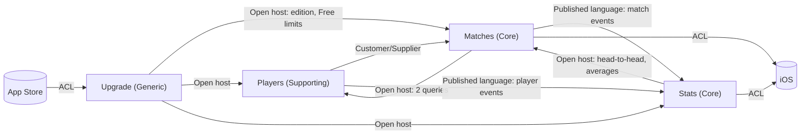

# Snooker Tracker

> Implemented using Domain-Driven Design (DDD) with a hexagonal / ports-and-adapters architecture.

## Purpose

An app (iOS first; Android and remote play to follow) for tracking pool and snooker matches between friends, scored live on one phone. Start a match from a template or by entering the details, tap who breaks, tap + or − as frames are won, pause, leave and come back, then finish, abandon or cancel. Every match is kept as a history, and stats show how you do against each opponent, on each day of the week, in deciders, and in the series you play regularly.

## Domain Model

### Subdomain Classification

- **Core:** Matches — fast, accurate scoring at the table is what the app is for
- **Core:** Stats — deciders, "Asher on Fridays" and series summaries are what make it more than a score counter
- **Supporting:** Players — names, colours, archive, merge, Me; needed, not special
- **Generic:** Upgrade — Free or Unlocked, the one-off in-app purchase and the Free limits; a thin wrapper over StoreKit
- **Generic (later):** Sync / record keeping — upload everything; a cross-cutting infrastructure concern

### Bounded Context Map

Details: [docs/domain/context-map.md](./docs/domain/context-map.md). Canvases: [Matches](./docs/domain/contexts/Matches.md) · [Players](./docs/domain/contexts/Players.md) · [Stats](./docs/domain/contexts/Stats.md) · [Upgrade](./docs/domain/contexts/Upgrade.md).

### Ubiquitous Language

From `docs/domain/glossary.md`, split by context (full tables in each canvas):

| Term | Context | Meaning |
|------|---------|---------|
| Match | Matches | One contest between two sides under a setup, live until finished, abandoned or cancelled |
| Side | Matches | One of the two players within a match, with its colour for this match |
| Setup | Matches | Players, game, match style with targets, break rule; a template's identity |
| Template | Matches | A setup that has been played, used to start matches quickly |
| Frame | Matches | One rack won by a side, with its length and breaker |
| Break rule | Matches | Alternate breaks or winner breaks |
| Correction | Matches | A change after a match ended; the original stays |
| Player | Players | A person with a unique name and a colour |
| Me | Players | The device owner's player |
| Archive / Merge / Remove | Players | Hide, fold together, or permanently delete players |
| Match record | Stats | An ended match as Stats sees it: result, timeline, deciders |
| Opponent | Stats | The other player, from Me's point of view |
| Decider / Match decider / Set decider | Stats | A frame won from level / that frame as the match's last / a deciding set at sets level |
| Head-to-head | Stats | All-time finished matches between two players: Matches, Frames, Deciders |
| Series | Stats | A named group of setups with a monthly summary |
| Edition | Upgrade | This device: Free or Unlocked, from one in-app purchase |
| Free limits | Upgrade | What Free allows: 1 live match, 5 active players, newest 10 matches, most frames wins, alternate breaks |
| Upgrade offer | Upgrade | "Upgrade now" in place, or the generic "Upgrade once, forever, to unlock" screen |

## Key Process Flows

- [System map](./docs/domain/system-map.md) — actors, aggregates, external systems and the commands/events between them, by scenario
- [Event map](./docs/domain/event-map.md) — every event, its cause, its reactions, and each aggregate's lifecycle
- [Scenario docs](./docs/domain/scenarios/) — one per scenario, each with a sequence diagram and plain-language flow

## Architecture

<!-- to be added by ddd-project-structure: pattern, layers, dependency rule, language (Swift), entry point -->

## Technical Decisions

| Decision | Record |
|----------|--------|
| Domain model baseline | [ADR-0001](./docs/adr/0001-domain-model-baseline.md) |
| Templates and match settings belong to Matches; Players ↔ Matches | [ADR-0002](./docs/adr/0002-templates-and-match-settings-belong-to-matches.md) |
| Stats built from published events; Stats ↔ Matches | [ADR-0003](./docs/adr/0003-stats-built-from-published-events.md) |
| Auto-pause detected on relaunch; lock screen shows the oldest live match | [ADR-0004](./docs/adr/0004-auto-pause-on-kill-and-oldest-match-on-lock-screen.md) |
| Auto-pause at the later of background time and last action | [ADR-0005](./docs/adr/0005-auto-pause-at-later-of-background-and-last-action.md) |
| A match is event-sourced | [ADR-0006](./docs/adr/0006-a-match-is-event-sourced.md) |
| No auto-pause when iOS wakes the app for a lock-screen button | [ADR-0007](./docs/adr/0007-no-auto-pause-when-ios-wakes-the-app-for-a-lock-screen-button.md) |
| Swipe to archive and remove players | [ADR-0008](./docs/adr/0008-swipe-to-archive-and-remove-players.md) |
| A merge moves matches with `MatchPlayerMoved` | [ADR-0009](./docs/adr/0009-a-merge-moves-matches-with-match-player-moved.md) |
| Free and Unlocked editions, one-off in-app purchase | [ADR-0010](./docs/adr/0010-free-and-unlocked-editions.md) |
| Upgrade context owns the edition and Free limits; each context enforces them | [ADR-0011](./docs/adr/0011-upgrade-context-owns-free-limits.md) |

## Requirements

- [DDD requirements](./docs/ddd-requirements.md) — the architectural constitution; its *Changes* section is the planner's input (generated by `/ddd requirements`)

## Repository Layout

| Folder | What |
|--------|------|
| `ios/` | iOS app: SwiftPM package (`Package.swift`), XcodeGen project (`project.yml`), app, Live Activity widget, tests |
| `docs/`, `specs/`, `PRODUCT.md` | Platform-neutral domain model, ADRs and specs, shared by every client |

Android and a web server for remote games will sit alongside `ios/`.

## Running Locally

iOS: `cd ios && xcodegen generate && open SnookerTracker.xcodeproj`. Package-only build and tests: `cd ios && swift build && swift test`.

## Tests

<!-- to be added: how to run the domain unit tests and the integration tests -->
