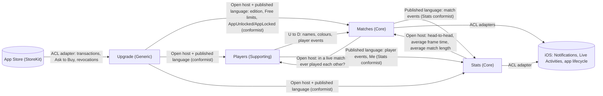

# Context Map

**Strategic revision:** ADR-0010
**Boundary decisions:** [ADR-0002](../adr/0002-templates-and-match-settings-belong-to-matches.md) · [ADR-0003](../adr/0003-stats-built-from-published-events.md) · [ADR-0011](../adr/0011-upgrade-context-owns-free-limits.md)

## Relationships

| Upstream | Downstream | Pattern | Contract owner | What flows | ADR |
|----------|------------|---------|----------------|------------|-----|
| Players | Matches | Customer/Supplier | Players | Player names, colours, archived flag; `PlayersMerged`, `PlayerRemoved` (Matches moves or deletes matches and templates) | 0002 |
| Matches | Players | Open host service (two queries) | Matches | "Is this player in a live match?" (archive guard), "Have these two ever played each other?" (merge guard) | 0002 |
| Matches | Stats | Published language, Stats conformist | Matches | Every match event, including the setup on `MatchStarted` | 0003 |
| Players | Stats | Published language, Stats conformist | Players | Player events; who Me is | 0003 |
| Stats | Matches | Open host service (queries) | Stats | Head-to-head for the live screen; average frame time and same-weekday average match length for the stale-match prompt | 0003 |
| iOS | Matches, Stats | Anti-corruption layer | Apple | Notifications, Live Activities, kill-detected-on-launch and launch signals, translated by adapters; no iOS types inside a context | — (obvious) |
| App Store | Upgrade | Anti-corruption layer | Apple | Verified purchases, Ask to Buy approvals, revocations, translated into `Unlock` / `Lock`; no StoreKit types inside Upgrade | 0011 |
| Upgrade | Matches, Players, Stats | Open host + published language; downstream conformist | Upgrade | Query "current edition and Free limits" (cached, works offline); events `AppUnlocked`, `AppLocked`. Each downstream enforces the limits on its own data and asks Upgrade to show the offer when refused | 0011 |

The two-way pairs (Players ↔ Matches, Matches ↔ Stats) each have one direction as events or supplied data and the other as a small, fixed set of queries owned by the answering context. No context reads another's store.

Upgrade sits upstream of everything and depends on none of the core contexts: it never counts players, matches or anything else (ADR-0011).

## Later contexts (not drawn yet)
- **Shared matches**: several devices contributing to one match, remote watching. Would join Matches' event history.
- **Leagues & tournaments**: possibly a separate app; would consume Matches' published events like Stats does.
- **Sync / record keeping**: not a domain context; a cross-cutting infrastructure concern (upload everything, 24).
