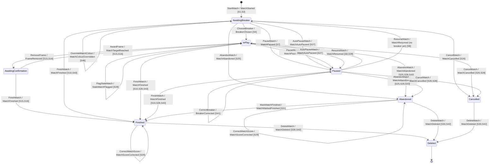
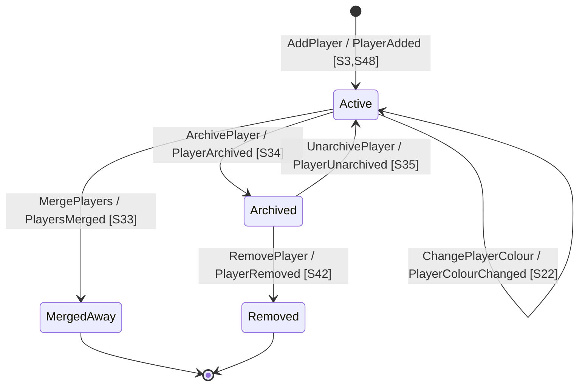
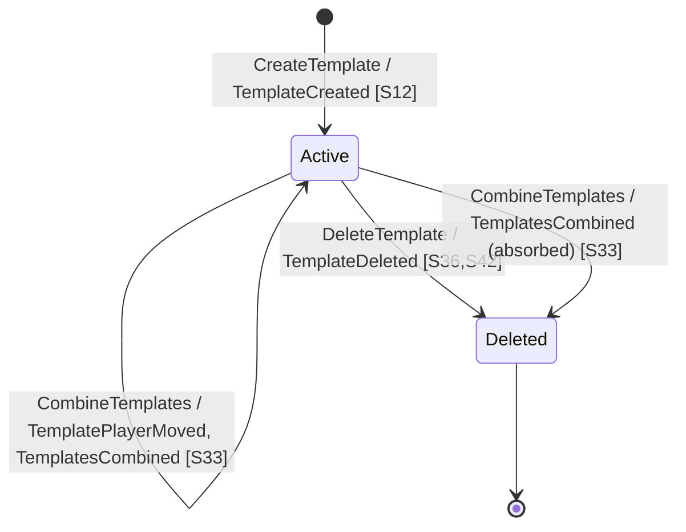
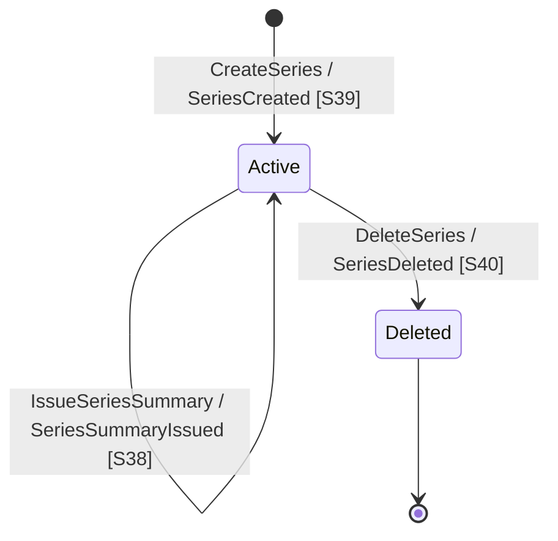
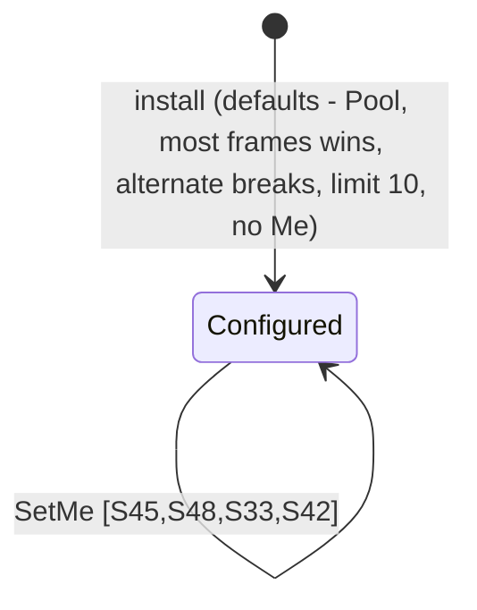
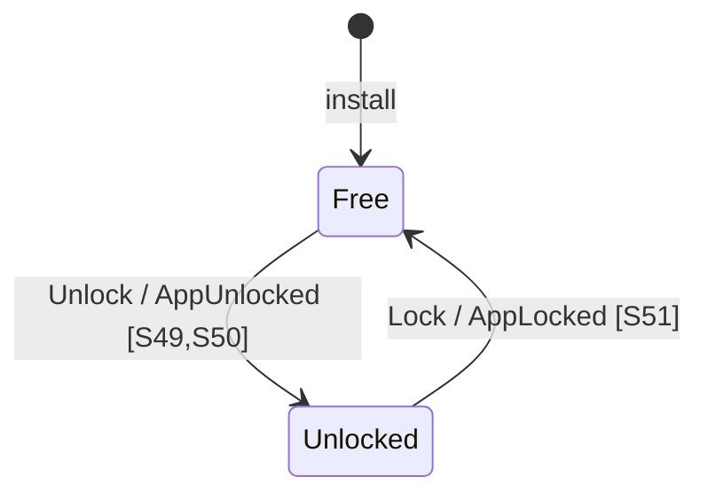

# Event Map

## Events

| Event | Raised by | Caused by (command ← actor) | Reactions (policy → command / external) | Scenarios |
|-------|-----------|-----------------------------|------------------------------------------|-----------|
| `MatchStarted` | `Match` | `StartMatch` ← Scorer | → `CreateTemplate` / `RecordTemplateUse` on `Template` (S12); → head-to-head shown (S14); → `OverrideMatchColour` offer when colours match (S46); → Live Activity shown if no other match is live (S47) | 1, 2, 12, 14, 46, 47 |
| `BreakerChosen` | `Match` | `ChooseBreaker` ← Scorer | → Live Activity updated (S47) | 4, 47 |
| `BreakerCorrected` | `Match` | `CorrectBreaker` ← Scorer | → Live Activity updated (S47) | 41, 47 |
| `FrameWon` | `Match` | `AwardFrame` ← Scorer (in app or lock screen) | → long-frame timer restarted (S37); → Live Activity updated (S47) | 5, 37, 47 |
| `SetWon` | `Match` | `AwardFrame` ← Scorer | → Continue/Undo prompt (S16) | 5, 16 |
| `MatchTargetReached` | `Match` | `AwardFrame` ← Scorer | → Finish/Undo prompt; Finish → `FinishMatch` (S10); Undo → `RemoveFrame` (S6) | 5, 15, 16 |
| `FrameRemoved` | `Match` | `RemoveFrame` ← Scorer | → Live Activity updated (S47) | 6, 15, 16, 47 |
| `MatchPaused` | `Match` | `PauseMatch` ← Scorer (in app or lock screen) | → long-frame warnings stopped (S37); → Live Activity updated (S47) | 7, 37, 47 |
| `MatchAutoPaused` | `Match` | `AutoPauseMatch` ← App lifecycle | → long-frame warnings stopped (S37); → Live Activity updated (S47) | 27, 37, 47 |
| `MatchResumed` | `Match` | `ResumeMatch` ← Scorer | → long-frame warnings resumed (S37); → Live Activity updated (S47) | 8, 28, 37, 47 |
| `LongFrameWarned` | `Match` | `WarnLongFrame` ← Clock | → iOS Notifications | 37 |
| `StaleMatchFlagged` | `Match` | `FlagStaleMatch` ← App lifecycle | → prompt: `ResumeMatch` (S8) / `FinishMatch` (S10) / `AbandonMatch` (S25) / `CancelMatch` (S26) | 28 |
| `MatchColourOverridden` | `Match` | `OverrideMatchColour` ← Scorer | none (shown on the live screen) | 46 |
| `MatchFinished` | `Match` | `FinishMatch` ← Scorer | → Live Activity handed to the next-oldest live match, or removed (S47); long-frame warnings stopped (S37) | 10, 15, 16, 28, 43, 47 |
| `MatchAbandoned` | `Match` | `AbandonMatch` ← Scorer | → Live Activity handed to the next-oldest live match, or removed (S47); long-frame warnings stopped (S37) | 25, 10, 28, 43, 47 |
| `MatchCancelled` | `Match` | `CancelMatch` ← Scorer | → Live Activity handed to the next-oldest live match, or removed (S47); long-frame warnings stopped (S37) | 26, 28, 47 |
| `MatchScoreCorrected` | `Match` | `CorrectMatchScore` ← Scorer | none (shown on the timeline; stats recalculate) | 29 |
| `MatchMarkedFinished` | `Match` | `MarkMatchFinished` ← Scorer | none (stats recalculate) | 31 |
| `MatchDeleted` | `Match` | `DeleteMatch` ← Scorer; policy on `PlayerRemoved` | none | 30, 42 |
| `MatchPlayerMoved` | `Match` | `MovePlayer` ← policy on `PlayersMerged` (ADR-0009) | none (Stats repoints its record; the live screen shows the kept player) | 33 |
| `PlayerAdded` | `Player` | `AddPlayer` ← Scorer | none | 2, 3, 48 |
| `PlayerRenamed` | `Player` | `RenamePlayer` ← Scorer | none | 32 |
| `PlayerColourChanged` | `Player` | `ChangePlayerColour` ← Scorer | none | 22 |
| `PlayersMerged` | `Player` | `MergePlayers` ← Scorer | → `MovePlayer` on each `Match`; → `CombineTemplates` on `Template`; → `ChangeSeries` on `Series`; → Me follows kept player on `Preferences` | 33 |
| `PlayerArchived` | `Player` | `ArchivePlayer` ← Scorer | none (read-side hiding) | 34 |
| `PlayerUnarchived` | `Player` | `UnarchivePlayer` ← Scorer | none | 35 |
| `PlayerRemoved` | `Player` | `RemovePlayer` ← Scorer | → `DeleteMatch` each (S30); → `DeleteTemplate` each; → `ChangeSeries` (remove setups); → clear Me on `Preferences` | 42 |
| `TemplateCreated` | `Template` | `CreateTemplate` ← policy on `MatchStarted` | none | 1, 2, 12 |
| `TemplateUsed` | `Template` | `RecordTemplateUse` ← policy on `MatchStarted` | none | 1, 12 |
| `TemplatePlayerMoved` | `Template` | `CombineTemplates` ← policy on `PlayersMerged` (moves the folded-in player first; not published) | none | 33 |
| `TemplatesCombined` | `Template` | `CombineTemplates` ← policy on `PlayersMerged` | none | 33 |
| `TemplateDeleted` | `Template` | `DeleteTemplate` ← Scorer; policy on `PlayerRemoved` | none | 36, 42 |
| `SeriesCreated` | `Series` | `CreateSeries` ← Scorer | none | 39 |
| `SeriesChanged` | `Series` | `ChangeSeries` ← Scorer; policy on `PlayersMerged` / `PlayerRemoved` | none | 40, 33, 42 |
| `SeriesDeleted` | `Series` | `DeleteSeries` ← Scorer | none | 40 |
| `SeriesSummaryIssued` | `Series` | `IssueSeriesSummary` ← Clock | → iOS Notifications | 38 |
| `AppUnlocked` | `Edition` | `Unlock` ← Scorer via App Store purchase (S49) or restore (S50); App Store approval arriving later (Ask to Buy) | → paid features and hidden matches shown; Upgrade menu item hidden (S53) | 49, 50, 53 |
| `AppLocked` | `Edition` | `Lock` ← App Store revocation (refund, Family Sharing ended) | → Free limits apply; Upgrade menu item shown (S53); Live Activity removed (S47) | 51, 53, 47 |

Settings (`Preferences`: defaults, live-match limit, Me) raise nothing: scenarios 20, 21, 44, 45.

Free-edition limits (ADR-0010) are rules read from `Edition` at the point of entry in the limited scenarios, not events. Touching a paid feature while Free shows the upgrade offer (S52), which raises nothing.

## Policies (when X → then Y)

| When | Then | On | Scenarios |
|------|------|----|-----------|
| `MatchStarted`, setup new | `CreateTemplate` | `Template` | 1, 2 → 12 |
| `MatchStarted`, setup known | `RecordTemplateUse` | `Template` | 1 → 12 |
| `MatchStarted` | show head-to-head (read model) | — | 1, 2 → 14 |
| `MatchStarted`, both players same colour | offer `OverrideMatchColour` | `Match` | 1, 2 → 46 |
| `MatchStarted` (no other live match), any event of the shown match | show / update Live Activity (oldest live match only) | iOS Lock Screen | → 47 |
| `MatchFinished` / `MatchAbandoned` / `MatchCancelled` | move Live Activity to the next-oldest live match, or remove it; stop long-frame warnings | iOS Lock Screen; Clock | 10, 25, 26 → 47, 37 |
| `FrameWon` / `MatchResumed` | restart / resume long-frame timer | Clock | 5, 8 → 37 |
| `MatchPaused` / `MatchAutoPaused` | stop long-frame timer | Clock | 7, 27 → 37 |
| `SetWon` | Continue/Undo prompt → `RemoveFrame` on Undo | `Match` | 5 → 16 → 6 |
| `MatchTargetReached` | Finish/Undo prompt → `FinishMatch` or `RemoveFrame` | `Match` | 5 → 15, 16 → 10 / 6 |
| `StaleMatchFlagged` | prompt → `ResumeMatch` / `FinishMatch` / `AbandonMatch` / `CancelMatch` | `Match` | 28 → 8, 10, 25, 26 |
| frame running 30 min, then every 10 min | `WarnLongFrame` | `Match` | 37 |
| app relaunched after a kill | `AutoPauseMatch` (at the later of the background time and the last action) | `Match` | 27 |
| app opened, match idle ≥ 6 h | `FlagStaleMatch` | `Match` | 28 |
| 1st of month | `IssueSeriesSummary` | `Series` | 38 |
| `LongFrameWarned` / `SeriesSummaryIssued` | notify | iOS Notifications | 37, 38 |
| `PlayersMerged` | `MovePlayer` each; `CombineTemplates`; `ChangeSeries`; Me follows | `Match`, `Template`, `Series`, `Preferences` | 33 |
| `PlayerRemoved` | `DeleteMatch` each; `DeleteTemplate` each; `ChangeSeries`; clear Me | `Match`, `Template`, `Series`, `Preferences` | 42 → 30 |
| a paid feature touched while Free | show upgrade offer (in place for templates and pause; generic screen otherwise) | — | 1, 2, 3, 7, 8, 11, 14–16, 18, 19, 21, 22, 35, 36, 38–40, 43, 44, 46, 47 → 52 |
| `AppUnlocked` / `AppLocked` | hide / show the Upgrade menu item; show / hide matches beyond the newest 10 | — | 49, 50, 51 → 53, 17 |
| `AppLocked` | remove Live Activity | iOS Lock Screen | 51 → 47 |

## Aggregate lifecycles

### Match

Finished, Abandoned and Cancelled are ended states (no play), each exitable only to Deleted. Finished never becomes Abandoned; Cancelled never changes how it ended. `MovePlayer / MatchPlayerMoved` [S33] is a self-transition in every state except Deleted (left out of the diagram).

### Player

### Template

A deleted setup played again creates a new template (S12).

### Series

### Preferences

Single per device; raises no events.

### Edition

Single per device, cached locally; offline never re-locks. Read by every limited scenario (ADR-0010).
