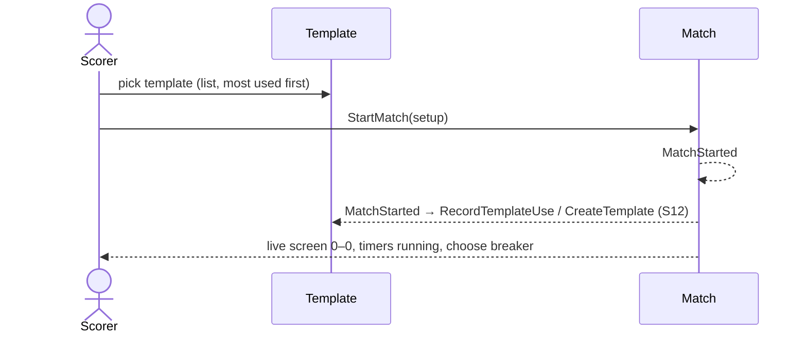

# 1 — Start a match from a template

**Type:** YOU
**Status:** new
**Source:** none
**History:** ADR-0001 (baseline)
**Actor:** Scorer
**Trigger / interface:** Main menu → New Match → template list (most used first) → tap a template
**Description:** A template is a setup played before (players, game, match style, break rule). Picking one sets up a new match ready to start; normally it is started as is. Any part can be changed with its edit icon before starting, which is rare. From there it behaves exactly like scenario 2.

## Relations
- Triggers: [12] via `MatchStarted` (template used, or a new template for an edited setup); [14] via `MatchStarted`; [46] via `MatchStarted`; [47] via `MatchStarted`
- Triggered by: [11] (track another)
- Depends on: [12] (templates exist), [2] (same start rules)

## Inputs
- A template; optional edits to players, game, match style or break rule

## Rules
- Same as scenario 2: two different players, valid targets ("best of" odd only), live-match limit (44) not reached
- If a player is already in a live match: "are you sure?" confirmation
- Templates involving an archived player are not listed

## Flow
1. Scorer taps New Match; templates exist, so the template list shows (header row has a **New** button → scenario 2)
2. Scorer taps a template; the setup is filled in
3. Optionally edits a part via its edit icon
4. Starts the match: it goes live at 0–0, day and time shown (full date stored), match timer and frame 1 timer running, no breaker chosen

## Failure paths
- Live-match limit reached → refused, explained
- Edited setup invalid (same player twice, even "best of", target < 1) → cannot start

## Domain Events Raised
- `MatchStarted` — setup, start time

## Reactions
- when `MatchStarted` → record template use, or create a template if the setup was edited into a new one (→ scenario 12)
- when `MatchStarted` → show head-to-head (→ scenario 14)
- when `MatchStarted` with both players the same colour → offer a temporary colour (→ scenario 46)
- when `MatchStarted` → show on the lock screen (→ scenario 47)

## Aggregates Touched
- `Match`, `Template`

## External Systems
- none

## Sequence Diagram

