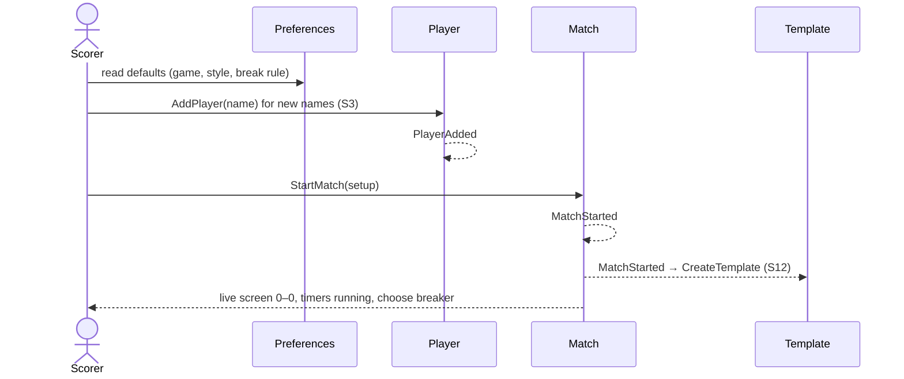

# 2 — Start a match by entering details

**Type:** YOU
**Status:** new
**Source:** none
**History:** ADR-0001 (baseline)
**Actor:** Scorer
**Trigger / interface:** Main menu → New Match when no templates exist (template list skipped), or the **New** button in the template list's header row
**Description:** The scorer enters two players, the game, the match style and the break rule, and starts a fresh match. On a brand-new install, or once every template is deleted or hidden, New Match comes straight here (absorbs scenario 13).

## Relations
- Triggers: [3] when a typed name is new; [12] via `MatchStarted`; [14] via `MatchStarted`; [46] via `MatchStarted`; [47] via `MatchStarted`
- Triggered by: [11] (track another)
- Depends on: [20], [21] (defaults), [44] (limit)
- Absorbed: [13] Skip the template screen when there are none (merged here)

## Inputs
- Two player names, typed with suggestions from recorded, non-archived players; an unknown name can be used as a new player (→ 3)
- Game: Pool or Snooker (default from settings; Pool out of the box)
- Match style (default from settings; *most frames wins* out of the box). Choosing another asks for its details:
  - Race to N frames, enterable as "best of" (odd only)
  - Sets: race to S sets, each race to F frames; both enterable as "best of" (odd only)
- Break rule: alternate (default) or winner breaks

## Rules
- The two players are different (nobody plays themselves)
- Names are not blank; names are unique, case-insensitive
- Targets are ≥ 1; "best of N" must be odd and is stored as race to ⌈N/2⌉; shown as entered; same setup either way
- An archived player's name is blocked, with an offer to remove that player completely (→ 42)
- Live-match limit (44) not reached
- If a player is already in a live match: "are you sure?" confirmation

## Flow
1. Scorer taps New Match; if no templates exist the details screen opens directly, otherwise the scorer taps **New** in the template list header
2. Enters the two names (new names become players, → 3), game, style, break rule
3. Starts the match: live at 0–0, day and time shown (full date stored), match timer and frame 1 timer start now, no breaker chosen; the only action allowed is choosing the breaker (→ 4)

## Failure paths
- Same player twice, blank name, even "best of", target < 1 → cannot start
- Archived player's name → blocked; offer removal (→ 42)
- Live-match limit reached → refused, explained

## Domain Events Raised
- `MatchStarted` — setup, start time
- `PlayerAdded` — per new name (via scenario 3)

## Reactions
- when `MatchStarted` → create a template for a new setup, else record its use (→ scenario 12)
- when `MatchStarted` → show head-to-head (→ scenario 14)
- when `MatchStarted` with both players the same colour → offer a temporary colour (→ scenario 46)
- when `MatchStarted` → show on the lock screen (→ scenario 47)

## Aggregates Touched
- `Match`, `Player`, `Template`, `Preferences` (read defaults)

## External Systems
- none

## Sequence Diagram

