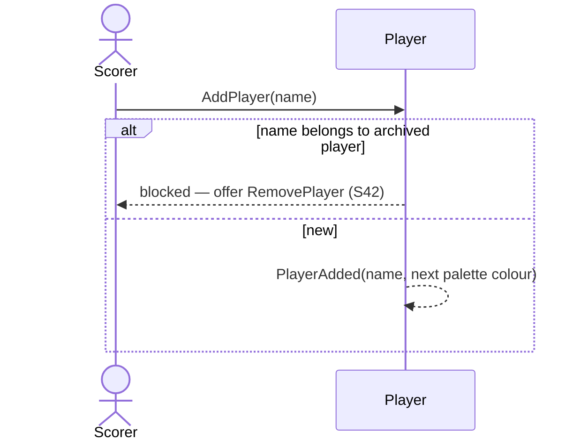

# 3 — Add a new player

**Type:** YOU
**Status:** new
**Source:** none
**History:** ADR-0001 (baseline)
**Actor:** Scorer
**Trigger / interface:** Match details screen: type a name that matches nobody and choose "use as new name"
**Description:** A new player is created with the typed name and the next unused colour from the palette. The player is created when the match starts, not while typing.

## Relations
- Triggered by: [2] (and [1] when a template is edited to a new name)
- Depends on: none

## Inputs
- A name

## Rules
- Name not blank; unique, case-insensitive ("callum" = "Callum")
- The name of an archived player is blocked, with an offer to remove that player completely (→ 42)
- Colour: next unused palette colour; when the palette is exhausted, colours repeat from the start

## Flow
1. Scorer types a name; no suggestion matches
2. Chooses "use as new name"
3. On match start the player is created with the next palette colour

## Failure paths
- Name taken by an active player → it is that player (suggested), not a new one
- Name taken by an archived player → blocked; offer removal (→ 42)

## Domain Events Raised
- `PlayerAdded` — name, colour

## Reactions
- none

## Aggregates Touched
- `Player`

## External Systems
- none

## Sequence Diagram

