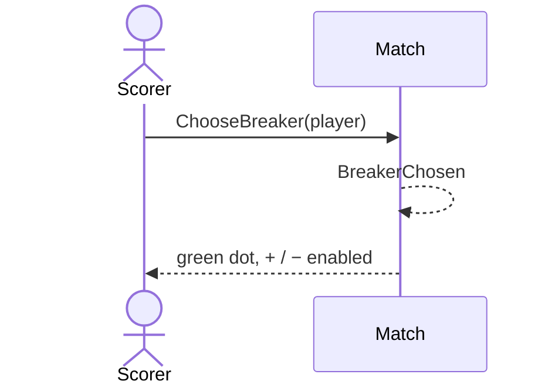

# 4 — Choose who breaks

**Type:** YOU
**Status:** new
**Source:** none
**History:** ADR-0001 (baseline)
**Actor:** Scorer
**Trigger / interface:** Live match screen: tap a player's name; a green dot shows next to the breaker
**Description:** At the start of a match nothing else can be done until the first breaker is chosen. After that the break is tracked automatically from the break rule.

## Relations
- Triggered by: [1], [2] (match awaiting breaker)
- Depends on: none
- Related: [41] corrects it later

## Inputs
- The player who breaks first

## Rules
- Match is awaiting its first breaker and not paused
- Next breaker is derived, never stored per frame:
  - Alternate breaks: the first breaker breaks the odd-numbered frames
  - Winner breaks: the winner of the last frame breaks next
- Sets do not affect the break; the rule carries on from frame to frame across sets

## Flow
1. Scorer taps a name
2. Green dot shows; + and − become available

## Failure paths
- Match paused → disabled

## Domain Events Raised
- `BreakerChosen` — player

## Reactions
- when `BreakerChosen` → update the lock screen (→ scenario 47)

## Aggregates Touched
- `Match`

## External Systems
- none

## Sequence Diagram

