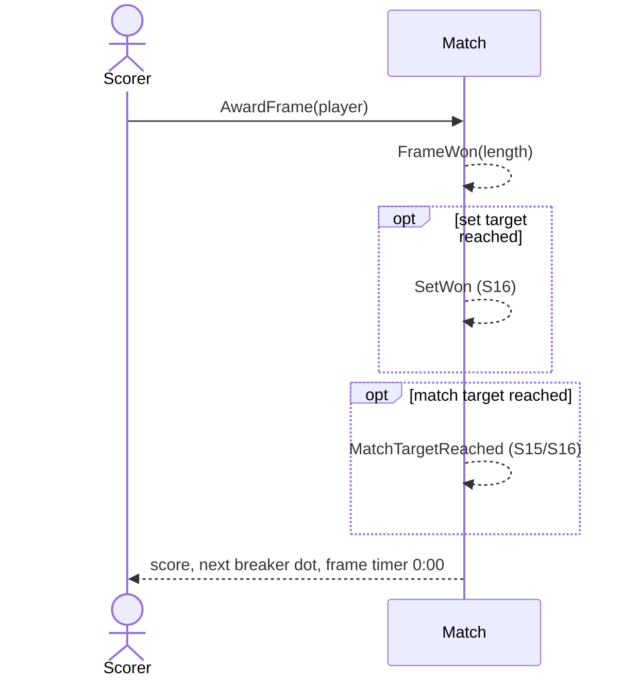

# 5 — Award a frame

**Type:** YOU
**Status:** new [?]
**Source:** none
**History:** ADR-0001 (baseline)
**Actor:** Scorer
**Trigger / interface:** Live match screen: tap + under a player (also from the lock screen, → 47)
**Description:** The player wins a frame: their score goes up by one, the frame's length is recorded, the next frame starts and the break moves by the break rule.

## Relations
- Triggers: [15] via `MatchTargetReached` (race to); [16] via `SetWon` / `MatchTargetReached` (sets); [37] (frame timer restarts); [47] via `FrameWon`
- Triggered by: [47] (lock-screen +)
- Depends on: [4]

## Inputs
- The player who won the frame

## Rules
- A breaker has been chosen; match is live and not paused (everything except resume is disabled while paused)
- Frame length = from frame start (match start for frame 1; the previous + otherwise) to now, minus paused time
- Frame lengths are approximate: frames are sometimes recorded late, so very short frames are probably missed records

## Flow
1. Scorer taps + under a player
2. Score +1; frame recorded (winner, number, set, length, breaker)
3. Next frame timer starts; next breaker derived by the break rule
4. If a set target is reached → scenario 16; if the match target is reached → scenario 15 / 16

## Failure paths
- No breaker yet, or paused → disabled
- Deferred: + tapped while a Finish/Undo prompt is showing (Q3)

## Domain Events Raised
- `FrameWon` — player, frame number, set number, length
- `SetWon` — when the frame wins a set (sets only)
- `MatchTargetReached` — when the frame reaches the match target (race to, sets)

## Reactions
- when `FrameWon` → restart the long-frame warning timer (→ scenario 37)
- when `FrameWon` → update the lock screen (→ scenario 47)
- when `SetWon` → "Continue?" prompt (→ scenario 16)
- when `MatchTargetReached` → "Finish?" prompt (→ scenario 15 / 16)

## Aggregates Touched
- `Match`

## External Systems
- none

## Sequence Diagram

