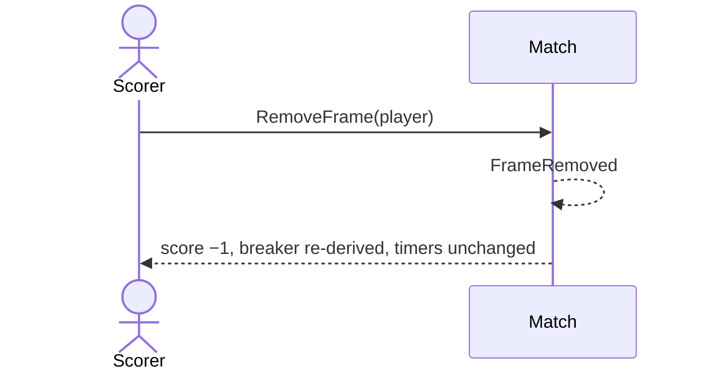

# 6 — Take a frame back

**Type:** YOU
**Status:** new [?]
**Source:** none
**History:** ADR-0001 (baseline)
**Actor:** Scorer
**Trigger / interface:** Live match screen: tap − under a player; also "Undo" on the Finish/Continue prompts (15, 16)
**Description:** Fixes a mistype. Removes that player's most recent frame. A frame given to the wrong player is fixed with − on one and + on the other.

## Relations
- Triggered by: [15], [16] (Undo)
- Triggers: [47] via `FrameRemoved`
- Depends on: [5]

## Inputs
- The player to take a frame from

## Rules
- The player has at least one frame; match not paused
- Never touches the timers (the mistake may be noticed a frame later)
- The break follows from the frames that remain (alternate: by frame count; winner breaks: by the last remaining frame's winner)
- Removing a set-winning frame reverts that set win

## Flow
1. Scorer taps −
2. That player's most recent frame is removed; the score drops by one; the breaker dot moves back if the rule says so

## Failure paths
- Player on 0 → disabled
- Paused → disabled
- Deferred: lock-screen + arriving at the same moment as an in-app − (Q4)

## Domain Events Raised
- `FrameRemoved` — player, frame number

## Reactions
- when `FrameRemoved` → update the lock screen (→ scenario 47)

## Aggregates Touched
- `Match`

## External Systems
- none

## Sequence Diagram

