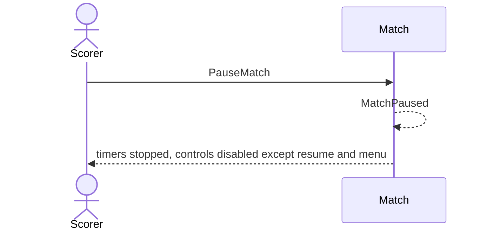

# 7 — Pause a match

**Type:** YOU
**Status:** new
**Source:** none
**History:** ADR-0001 (baseline) · ADR-0010 (changed: paid)
**Actor:** Scorer
**Trigger / interface:** Live match screen: pause button
**Description:** Stops the match timer, the frame timer and the long-frame warning timer. While paused everything is disabled except resume and the match menu.

## Relations
- Triggers: [47] via `MatchPaused`; stops [37]
- Related: [8] resumes; [27] is the automatic version

## Inputs
- none

## Rules
- **Edition (ADR-0010):** Paid. While the edition is Free, this opens the upgrade offer (→ 52). The pause button shows an "Upgrade now" prompt in place. Auto-pause after a kill (27) stays free
- Match is live and not already paused
- While paused: +, −, choosing the breaker are disabled; the menu (finish, abandon, cancel, correct breaker) still works

## Flow
1. Scorer taps pause; timers stop

## Failure paths
- Already paused → only resume is offered

## Domain Events Raised
- `MatchPaused`

## Reactions
- when `MatchPaused` → stop the long-frame warnings (→ scenario 37)
- when `MatchPaused` → update the lock screen (→ scenario 47)

## Aggregates Touched
- `Match`

## External Systems
- none

## Sequence Diagram

