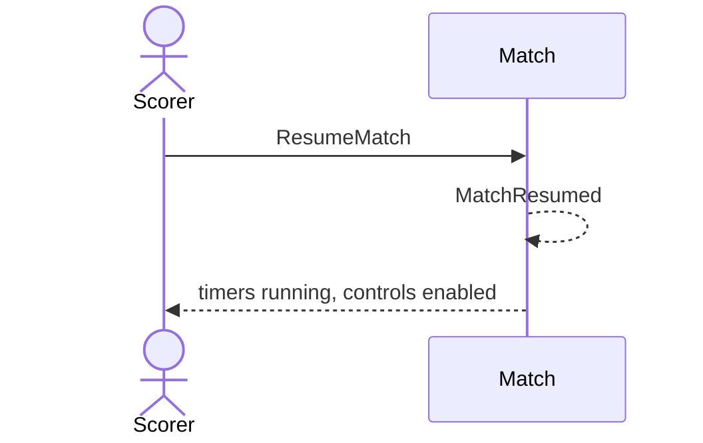

# 8 — Resume a match

**Type:** YOU
**Status:** new
**Source:** none
**History:** ADR-0001 (baseline)
**Actor:** Scorer
**Trigger / interface:** Live match screen: resume button; or "resume" in the stale-match prompt (28)
**Description:** Restarts the match timer, the frame timer and the long-frame warning timer.

## Relations
- Triggered by: [28] (resume option)
- Triggers: [47] via `MatchResumed`; restarts [37]
- Depends on: [7] or [27]

## Inputs
- none

## Rules
- Match is paused

## Flow
1. Scorer taps resume; timers continue from where they stopped; controls re-enabled

## Failure paths
- Not paused → no resume shown

## Domain Events Raised
- `MatchResumed`

## Reactions
- when `MatchResumed` → resume the long-frame warnings (→ scenario 37)
- when `MatchResumed` → update the lock screen (→ scenario 47)

## Aggregates Touched
- `Match`

## External Systems
- none

## Sequence Diagram

