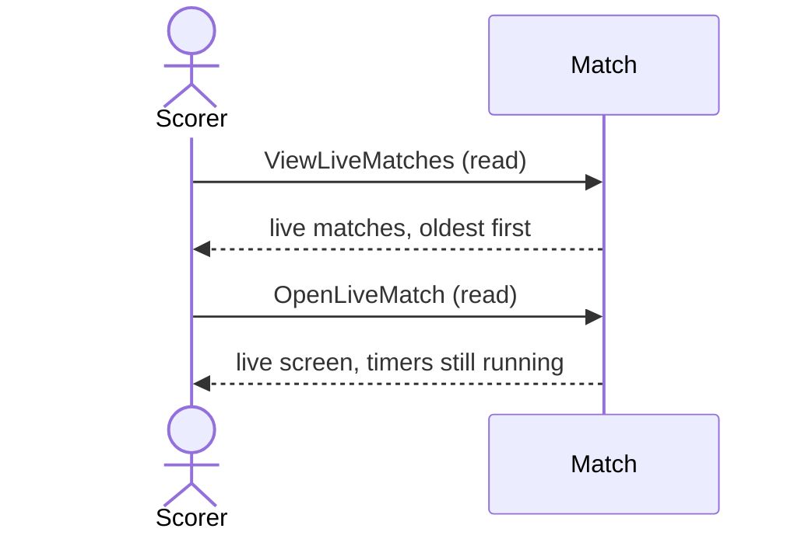

# 9 — Return to a live match

**Type:** YOU
**Status:** new
**Source:** none
**History:** ADR-0001 (baseline)
**Actor:** Scorer
**Trigger / interface:** Live match screen → back to main menu; main menu → **Live matches** list → tap a match
**Description:** Leaving the match screen pauses nothing (like switching apps to answer messages). The main menu shows a Live matches list, oldest started first; tapping one returns to it.

## Relations
- Related: [11], [43]

## Inputs
- The live match to return to

## Rules
- Leaving the screen or the app (switching apps, locking the phone) never pauses a match; only shutdown does (→ 27)

## Flow
1. Scorer goes back to the main menu; timers keep running
2. Taps a match in Live matches; the live screen shows its current state

## Failure paths
- none

## Domain Events Raised
- raises nothing (navigation only)

## Reactions
- none

## Aggregates Touched
- `Match` (read)

## External Systems
- none

## Sequence Diagram

