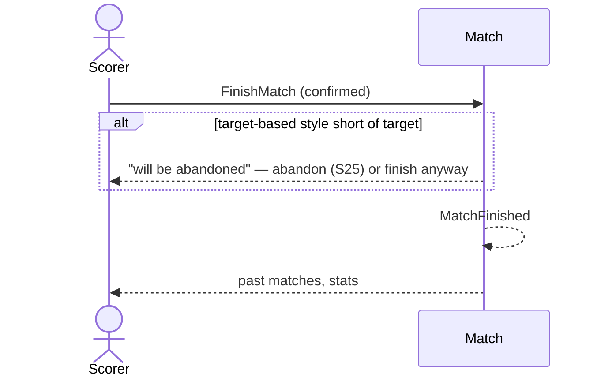

# 10 — Finish a match

**Type:** YOU
**Status:** new
**Source:** none
**History:** ADR-0001 (baseline)
**Actor:** Scorer
**Trigger / interface:** Match menu (burger) → Finish → confirmation dialog; or Finish on the target-reached prompt (15, 16)
**Description:** Ends the match as finished. Final score, end time and length are recorded; it moves to past matches and counts in stats.

## Relations
- Triggered by: [11] (end the live one), [15], [16], [28], [43]
- Triggers: [47] via `MatchFinished`; stops [37]

## Inputs
- Confirmation

## Rules
- Match is live (paused or not)
- Most frames wins: can be finished at any time; a level score is a **draw**
- Race to / sets before the target: warns the match will be **abandoned** (→ 25), with the choice to mark it finished anyway; then whoever is ahead wins, level is a draw
- A frame in progress when the match ends is dropped
- Deciders (computed from the frames):
  - **Decider**: a frame won from level at the end of a set or a frames-style match (e.g. 8–8 → 9–8), in any set
  - **Match decider**: such a frame that is the match's last frame (also counts as a decider)
  - **Set decider**: a deciding set played with sets level (e.g. 2–2 in race to 3); counted only on its own

## Flow
1. Scorer opens the menu, taps Finish, confirms
2. Match ends as finished; result, end time, length recorded

## Failure paths
- Race to / sets short of target → abandon warning (→ 25) unless marked finished anyway
- Confirmation declined → nothing changes

## Domain Events Raised
- `MatchFinished` — result (win/draw), end time, length

## Reactions
- when `MatchFinished` → remove from the lock screen (→ scenario 47); stop long-frame warnings (→ scenario 37)

## Aggregates Touched
- `Match`

## External Systems
- none

## Sequence Diagram

