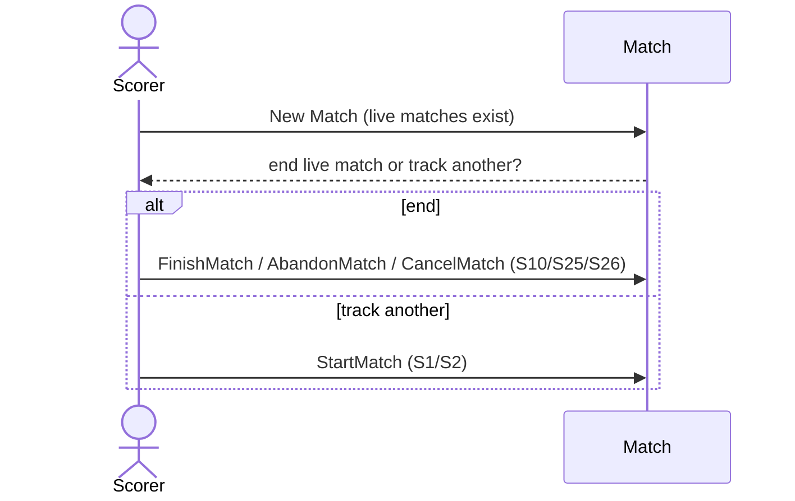

# 11 — New match while one is live

**Type:** YOU
**Status:** new
**Source:** none
**History:** ADR-0001 (baseline)
**Actor:** Scorer
**Trigger / interface:** Main menu → New Match while at least one match is live
**Description:** The app asks: end the live match (finish, abandon or cancel) or track another. Tracking another means several matches are live at once, all timers running.

## Relations
- Triggers: [10], [25], [26] (end the live one); [1], [2] (track another)
- Depends on: [44] (limit)

## Inputs
- The choice: end or track another

## Rules
- Up to the live-match limit (default 10, max 100)
- A player already in a live match can be in another after "are you sure?"

## Flow
1. Scorer taps New Match; the prompt shows
2. End → the finish / abandon / cancel choice for the live match; or Track another → scenario 1 or 2

## Failure paths
- Limit reached → "track another" refused

## Domain Events Raised
- raises nothing (routes to other scenarios)

## Reactions
- none

## Aggregates Touched
- `Match` (read)

## External Systems
- none

## Sequence Diagram

