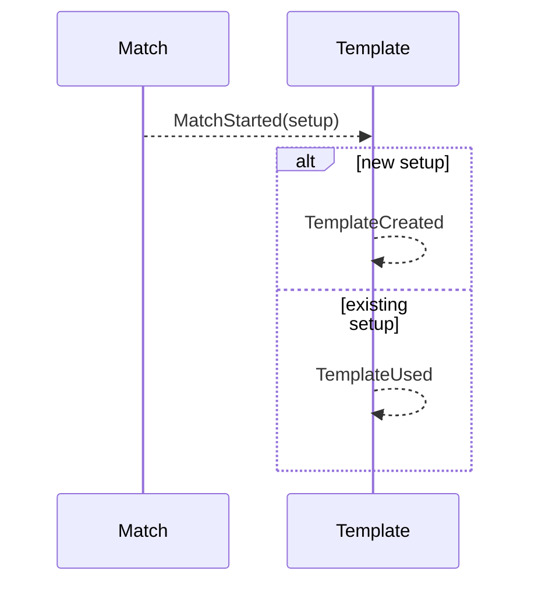

# 12 — Create or use a template from a setup

**Type:** AUTO
**Status:** new
**Source:** none
**History:** ADR-0001 (baseline)
**Actor:** policy (reaction to `MatchStarted`)
**Trigger / interface:** `MatchStarted`
**Description:** Every new setup becomes a template as soon as its match starts; an existing setup's use count goes up. A template is identified by its whole setup: the two players (order doesn't matter), the game, the match style with its targets, and the break rule. Templates are listed most used first.

## Relations
- Triggered by: [1], [2] via `MatchStarted`
- Related: [36] deletes; [33] combines

## Inputs
- The match's setup

## Rules
- Setup identity is unordered in players ("Callum vs Asher" = "Asher vs Callum"); "best of 3" and "race to 2" are the same setup
- A deleted template comes back when the setup is played again; its use count restarts from that match
- Cancelled matches still count (the template is created at start)

## Flow
1. Match starts
2. If no template has this setup → create it with use count 1; else increment its use count

## Failure paths
- none

## Domain Events Raised
- `TemplateCreated` — setup
- `TemplateUsed` — setup, new use count

## Reactions
- none

## Aggregates Touched
- `Template`

## External Systems
- none

## Sequence Diagram

