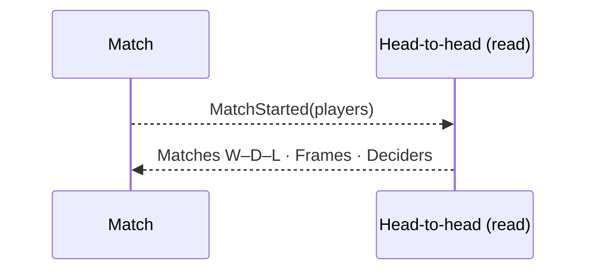

# 14 — Show head-to-head on the live match

**Type:** AUTO
**Status:** new
**Source:** none
**History:** ADR-0001 (baseline)
**Actor:** policy (reaction to `MatchStarted`)
**Trigger / interface:** `MatchStarted`; shown on the live match screen
**Description:** The live screen shows the all-time head-to-head for the two players, in order: Matches (won–drawn–lost), Frames, Deciders (only shown when there is a value).

## Relations
- Triggered by: [1], [2] via `MatchStarted`
- Related: [18] (same figures, filterable)

## Inputs
- The two players

## Rules
- Counts every **finished** match between the two players, in any game and any style; abandoned and cancelled excluded
- The live match itself is not included

## Flow
1. On match start, the head-to-head is computed and shown

## Failure paths
- No history → section hidden or zeros

## Domain Events Raised
- raises nothing (read model)

## Reactions
- none

## Aggregates Touched
- `Match` (read)

## External Systems
- none

## Sequence Diagram

