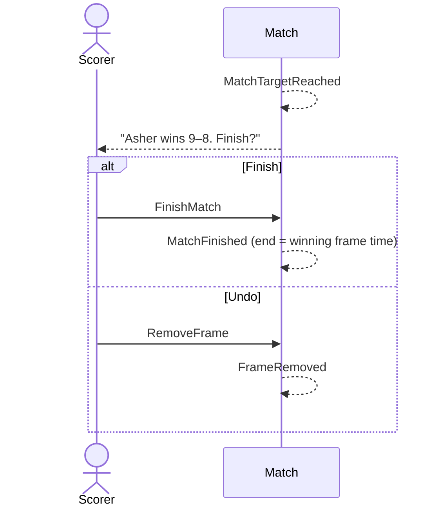

# 15 — Race-to match won

**Type:** AUTO
**Status:** new [?]
**Source:** none
**History:** ADR-0001 (baseline)
**Actor:** policy (reaction to `FrameWon`)
**Trigger / interface:** A frame takes a player to the race-to target
**Description:** The app asks "Asher wins 9–8. Finish?" with Finish and Undo. The match only ends on Finish; Undo takes the frame back off.

## Relations
- Triggered by: [5] via `MatchTargetReached`
- Triggers: [10] (Finish), [6] (Undo)

## Inputs
- none

## Rules
- Only race-to style
- The end time is when the winning frame was scored, not when Finish was tapped

## Flow
1. + takes a player to the target; `MatchTargetReached`
2. Prompt shows; Finish → `MatchFinished`; Undo → `FrameRemoved`, play continues

## Failure paths
- Deferred: + tapped while the prompt is showing (Q3)

## Domain Events Raised
- `MatchTargetReached` — winner, score

## Reactions
- when `MatchTargetReached` → Finish/Undo prompt; Finish → `MatchFinished` (→ scenario 10); Undo → `FrameRemoved` (→ scenario 6)

## Aggregates Touched
- `Match`

## External Systems
- none

## Sequence Diagram

