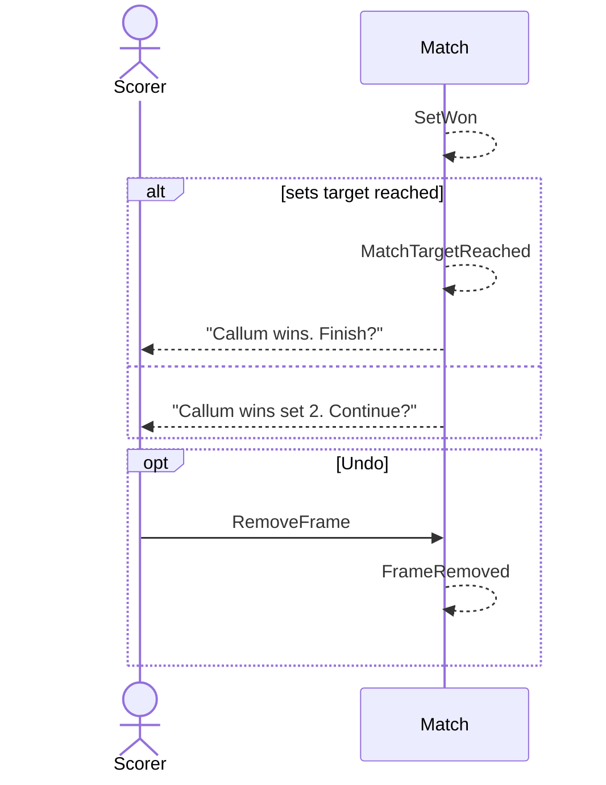

# 16 — Set won, sets match won

**Type:** AUTO
**Status:** new [?]
**Source:** none
**History:** ADR-0001 (baseline)
**Actor:** policy (reaction to `FrameWon`)
**Trigger / interface:** A frame takes a player to the frames target of a set
**Description:** Winning a set prompts "Callum wins set 2. Continue?" with Continue and Undo. Winning the deciding number of sets prompts Finish / Undo as in scenario 15. The live score reads **(1) 5 – 2 (0)**: sets won in brackets, current-set frames in the middle.

## Relations
- Triggered by: [5] via `SetWon` / `MatchTargetReached`
- Triggers: [10] (Finish), [6] (Undo)

## Inputs
- none

## Rules
- Only sets style
- Sets are a grouping of frames; the break rule carries straight on across sets
- After a set, current-set frame scores reset to 0–0
- Match end time is when the winning frame was scored

## Flow
1. + wins a set → `SetWon` → Continue / Undo
2. If that set reaches the sets target → `MatchTargetReached` → Finish / Undo

## Failure paths
- Deferred: + tapped while a prompt is showing (Q3)

## Domain Events Raised
- `SetWon` — winner, set number, set score
- `MatchTargetReached` — winner, sets score

## Reactions
- when `SetWon` → Continue/Undo prompt; Undo → `FrameRemoved` (→ scenario 6)
- when `MatchTargetReached` → Finish/Undo prompt (→ scenario 10 / 6)

## Aggregates Touched
- `Match`

## External Systems
- none

## Sequence Diagram

