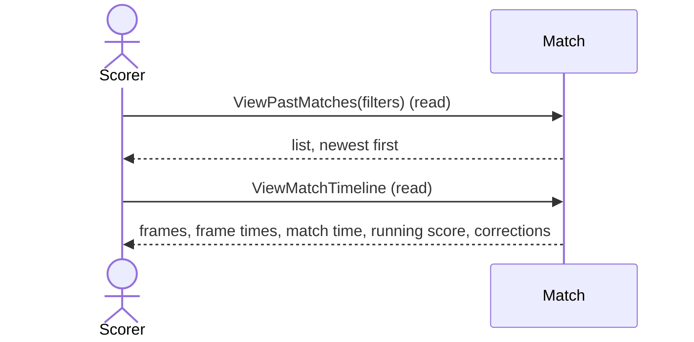

# 17 — View past matches

**Type:** YOU
**Status:** new
**Source:** none
**History:** ADR-0001 (baseline) · ADR-0010 (changed: Free edition shows the newest 10 ended matches)
**Actor:** Scorer
**Trigger / interface:** Past matches list; tap a row for its timeline; swipe a row for delete (→ 30)
**Description:** A list of ended matches, newest first: day and time, players, score, style, finished or abandoned. Tapping one shows its timeline: each frame with its winner, frame time, match time at that point and running score; later corrections are shown and marked as corrections.

## Relations
- Related: [29], [30], [31] start from here

## Inputs
- Filters: show cancelled; include archived players

## Rules
- **Edition (ADR-0010):** Free: the newest 10 ended matches are shown; older ones are hidden, never deleted, with a line saying how many (tapping it opens the upgrade offer → 52). All appear on unlock
- Cancelled matches hidden unless "show cancelled"
- Matches with an archived player hidden unless "include archived players"

## Flow
1. Scorer opens past matches; sets filters
2. Taps a match → timeline

## Failure paths
- none

## Domain Events Raised
- raises nothing (read model)

## Reactions
- none

## Aggregates Touched
- `Match` (read)

## External Systems
- none

## Sequence Diagram

