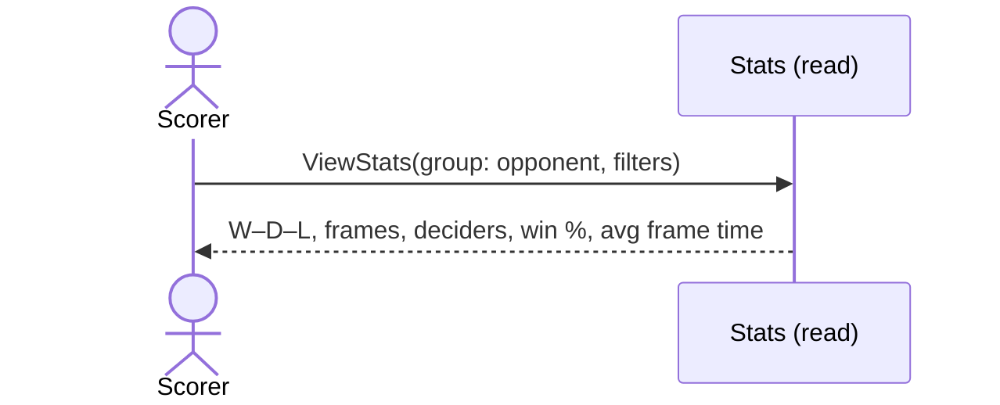

# 18 — Stats by opponent

**Type:** YOU
**Status:** new
**Source:** none
**History:** ADR-0001 (baseline) · ADR-0010 (changed: paid)
**Actor:** Scorer
**Trigger / interface:** Stats screen, grouped by opponent
**Description:** Shows a player's record against each opponent (by default "Me"; if Me isn't set, the scorer picks a player). Combinable with day of the week (19), e.g. "Asher on Fridays".

## Relations
- Related: [19] (combinable), [14] (same figures live), [45] (Me)

## Inputs
- Filters: opponent, day of the week, game, match style, series, date range, include abandoned, include archived players

## Rules
- **Edition (ADR-0010):** Paid. While the edition is Free, this opens the upgrade offer (→ 52)
- Figures: matches won–drawn–lost, frames won–lost, deciders won–lost, match deciders, set deciders (separate tally), win %, average frame time (also per player)
- Abandoned excluded unless "include abandoned"; cancelled never counted
- Archived players' matches excluded unless "include archived players"

## Flow
1. Scorer opens Stats; picks filters; sees figures per opponent

## Failure paths
- Me not set → asks which player to look at

## Domain Events Raised
- raises nothing (read model)

## Reactions
- none

## Aggregates Touched
- `Match` (read), `Player` (read), `Series` (read), `Preferences` (read)

## External Systems
- none

## Sequence Diagram

