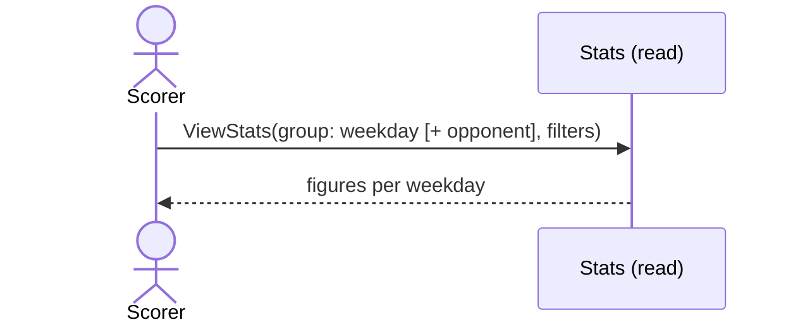

# 19 — Stats by day of the week

**Type:** YOU
**Status:** new
**Source:** none
**History:** ADR-0001 (baseline)
**Actor:** Scorer
**Trigger / interface:** Stats screen, grouped by day of the week
**Description:** Same figures as scenario 18, grouped by the weekday matches were played (e.g. every-other-Friday matches). Combinable with the opponent grouping.

## Relations
- Related: [18] (combinable)

## Inputs
- Same filters as scenario 18

## Rules
- Day of week comes from the match's start time
- Same inclusion rules as scenario 18

## Flow
1. Scorer groups by day of the week; optionally also by opponent

## Failure paths
- Me not set → asks which player to look at

## Domain Events Raised
- raises nothing (read model)

## Reactions
- none

## Aggregates Touched
- `Match` (read), `Player` (read), `Preferences` (read)

## External Systems
- none

## Sequence Diagram

