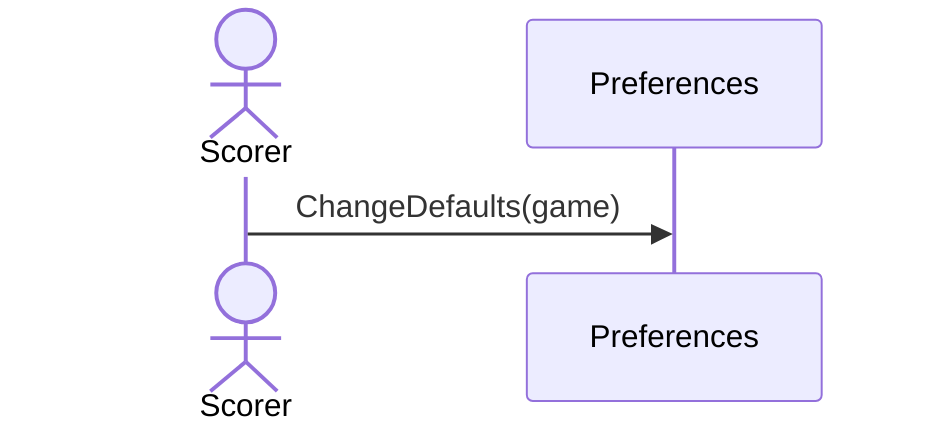

# 20 — Change the default game

**Type:** YOU
**Status:** new
**Source:** none
**History:** ADR-0001 (baseline)
**Actor:** Scorer
**Trigger / interface:** Settings → default game (Pool / Snooker)
**Description:** Sets the game preselected when entering match details. Only affects matches started afterwards.

## Relations
- Used by: [2]

## Inputs
- Pool or Snooker

## Rules
- Pool out of the box

## Flow
1. Scorer changes the setting

## Failure paths
- none

## Domain Events Raised
- raises nothing (a setting; no case for undo)

## Reactions
- none

## Aggregates Touched
- `Preferences`

## External Systems
- none

## Sequence Diagram

