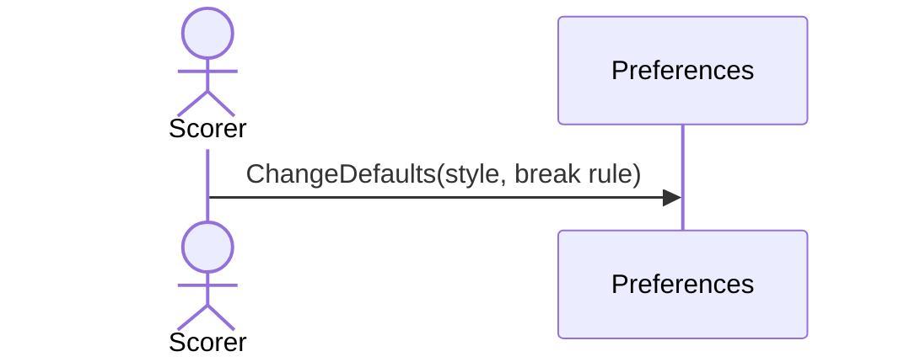

# 21 — Change the default match style and break rule

**Type:** YOU
**Status:** new
**Source:** none
**History:** ADR-0001 (baseline)
**Actor:** Scorer
**Trigger / interface:** Settings → default match style; default break rule
**Description:** Sets the style (with its targets) and the break rule preselected when entering match details. Only affects matches started afterwards.

## Relations
- Used by: [2]

## Inputs
- Match style and targets; break rule

## Rules
- Most frames wins and alternate breaks out of the box
- Same target rules as scenario 2

## Flow
1. Scorer changes the setting

## Failure paths
- Invalid target (even "best of", < 1) → refused

## Domain Events Raised
- raises nothing (a setting; no case for undo)

## Reactions
- none

## Aggregates Touched
- `Preferences`

## External Systems
- none

## Sequence Diagram

