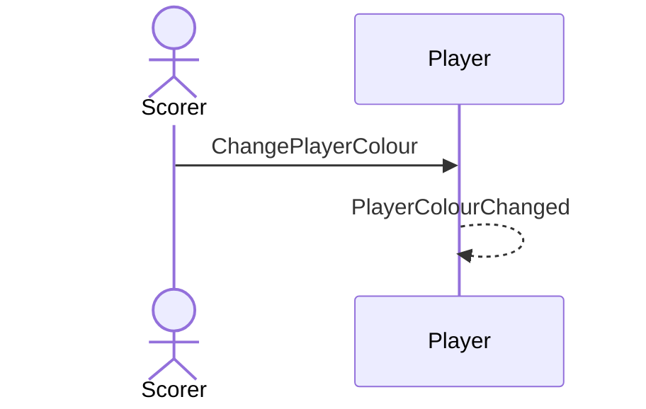

# 22 — Set a player's colour

**Type:** YOU
**Status:** new
**Source:** none
**History:** ADR-0001 (baseline)
**Actor:** Scorer
**Trigger / interface:** Settings → Players → a player → colour
**Description:** The colour helps the scorer spot who to tap when coming back to the phone. Colours may repeat.

## Relations
- Related: [46] (temporary colour within a match)

## Inputs
- Player, colour

## Rules
- No uniqueness rule on colours

## Flow
1. Scorer picks a colour

## Failure paths
- none

## Domain Events Raised
- `PlayerColourChanged`

## Reactions
- none

## Aggregates Touched
- `Player`

## External Systems
- none

## Sequence Diagram

