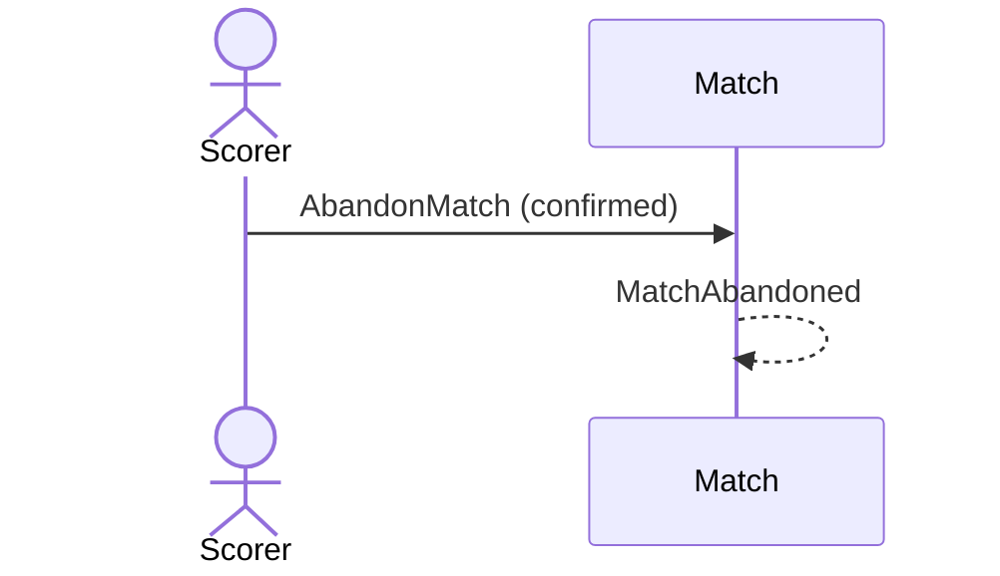

# 25 — Abandon a match

**Type:** YOU
**Status:** new
**Source:** none
**History:** ADR-0001 (baseline)
**Actor:** Scorer
**Trigger / interface:** Match menu → Abandon → confirmation; also the result of finishing a race-to / sets match early (10), finish all (43), or the stale-match prompt (28)
**Description:** Ends the match as abandoned. It stays in past matches but is left out of stats unless the stats filter includes abandoned matches. A match started with the wrong players or style is abandoned.

## Relations
- Triggered by: [10] (early finish of target styles), [11], [28], [43]
- Triggers: [47] via `MatchAbandoned`; stops [37]
- Related: [31] can turn it into finished

## Inputs
- Confirmation

## Rules
- Match is live (paused or not)
- A frame in progress is dropped

## Flow
1. Scorer opens the menu, taps Abandon, confirms

## Failure paths
- Confirmation declined → nothing changes

## Domain Events Raised
- `MatchAbandoned` — score, end time, length

## Reactions
- when `MatchAbandoned` → remove from the lock screen (→ scenario 47); stop long-frame warnings (→ scenario 37)

## Aggregates Touched
- `Match`

## External Systems
- none

## Sequence Diagram

