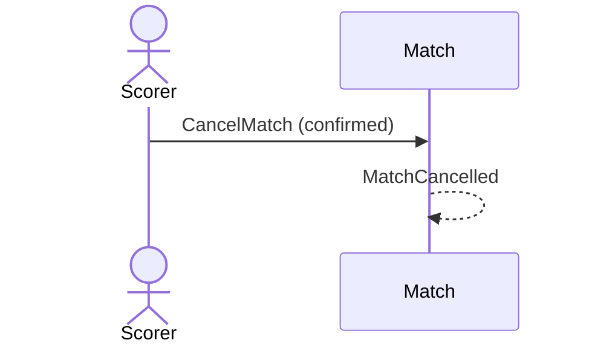

# 26 — Cancel a match

**Type:** YOU
**Status:** new
**Source:** none
**History:** ADR-0001 (baseline)
**Actor:** Scorer
**Trigger / interface:** Match menu → Cancel → confirmation; or the stale-match prompt (28)
**Description:** Ends the match as cancelled. It is hidden from past matches, but kept: the "show cancelled" filter brings it back ("did we play that day? oh yes, we went to dinner"). Never counted in stats.

## Relations
- Triggered by: [11], [28]
- Triggers: [47] via `MatchCancelled`; stops [37]

## Inputs
- Confirmation

## Rules
- Match is live (paused or not)
- A cancelled match can never change how it ended

## Flow
1. Scorer opens the menu, taps Cancel, confirms

## Failure paths
- Confirmation declined → nothing changes

## Domain Events Raised
- `MatchCancelled`

## Reactions
- when `MatchCancelled` → remove from the lock screen (→ scenario 47); stop long-frame warnings (→ scenario 37)

## Aggregates Touched
- `Match`

## External Systems
- none

## Sequence Diagram

