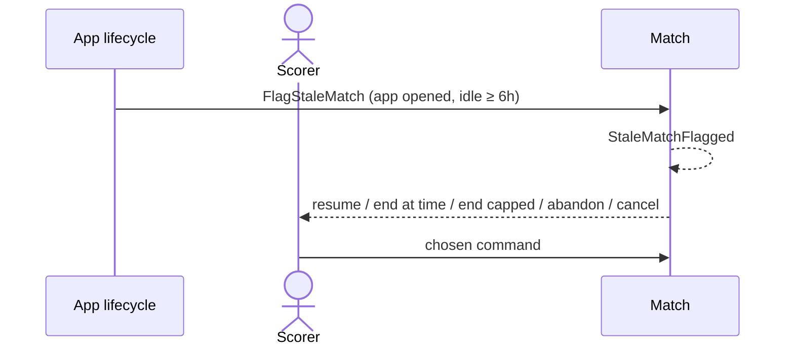

# 28 — Resolve a stale match

**Type:** AUTO
**Status:** new
**Source:** none
**History:** ADR-0001 (baseline)
**Actor:** App lifecycle
**Trigger / interface:** App opens and a live match has had no action for 6 hours or more
**Description:** For each stale match, one at a time, the app asks what to do: resume; end it at a time you choose; end it with a capped length; abandon; or cancel. Both lengths are shown side by side, e.g. "Ran 1d 4h 2s · Capped: 2h 45m (Fridays with Asher average)".

## Relations
- Triggers: [8] (resume), [10] (end), [25] (abandon), [26] (cancel)
- Related: [27]

## Inputs
- The choice per match; an end time if choosing one

## Rules
- "No action" = no score change, breaker choice or pause/resume
- **End at a time you choose:** suggested time = last frame time + the average frame time of whoever won it (this match's own average if they have no history); adjustable, no earlier than the last recorded action and no later than now
- **Capped length:** the average length of past matches with the same two players on the same weekday (e.g. a series' Friday matches), or 3 hours if there are none
- The cap applies only here; nothing else caps a match. Match length is a third-class figure; outliers can be excluded later by advanced stats

## Flow
1. App opens; stale matches flagged
2. For each, the prompt shows both lengths and the options
3. The chosen command runs

## Failure paths
- Chosen end time outside the bounds → refused

## Domain Events Raised
- `StaleMatchFlagged` — idle time, suggested end time, capped length
- then one of `MatchResumed`, `MatchFinished`, `MatchAbandoned`, `MatchCancelled`

## Reactions
- when `StaleMatchFlagged` → prompt; resume (→ scenario 8), finish (→ scenario 10), abandon (→ scenario 25), cancel (→ scenario 26)

## Aggregates Touched
- `Match`

## External Systems
- iOS app lifecycle

## Sequence Diagram

