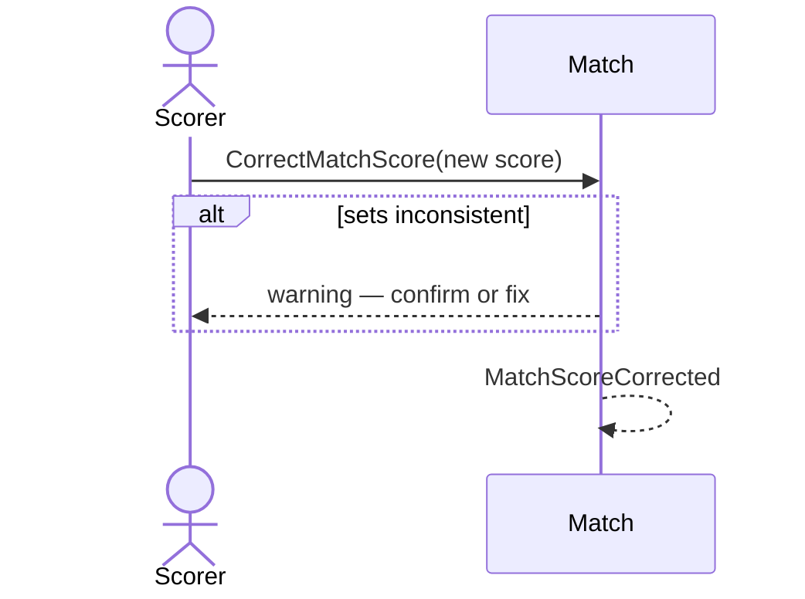

# 29 — Correct an ended match's score

**Type:** YOU
**Status:** new [?]
**Source:** none
**History:** ADR-0001 (baseline)
**Actor:** Scorer
**Trigger / interface:** Past match timeline → Edit: + and − per player, plus a text box to type a whole score; for sets, each set's frame score is shown separately and edited per set
**Description:** Corrects a finished or abandoned match. Recorded as a correction after the end; the original result stays in the history. Winner, deciders and stats are recalculated.

## Relations
- Triggered by: [17]

## Inputs
- New score (per set for sets)

## Rules
- Race to: exactly one player on the target (race to 9 accepts 9–7; refuses 7–5 and 9–9)
- Sets: the app does not recalculate; it checks consistency and warns (e.g. "4–5 means the right-hand player won this set. Correct?"); confirming saves anyway
- Cancelled matches cannot be corrected
- Added frames have no time; the timeline marks them as corrections

## Flow
1. Scorer opens the edit screen; adjusts with +/− or types the score
2. Saves; correction recorded

## Failure paths
- Race-to score not on target → refused
- Sets inconsistency → warning; confirm or fix
- Deferred: phone dies mid-correction (Q1); two corrections in a row (Q2)

## Domain Events Raised
- `MatchScoreCorrected` — before, after

## Reactions
- none

## Aggregates Touched
- `Match`

## External Systems
- none

## Sequence Diagram

