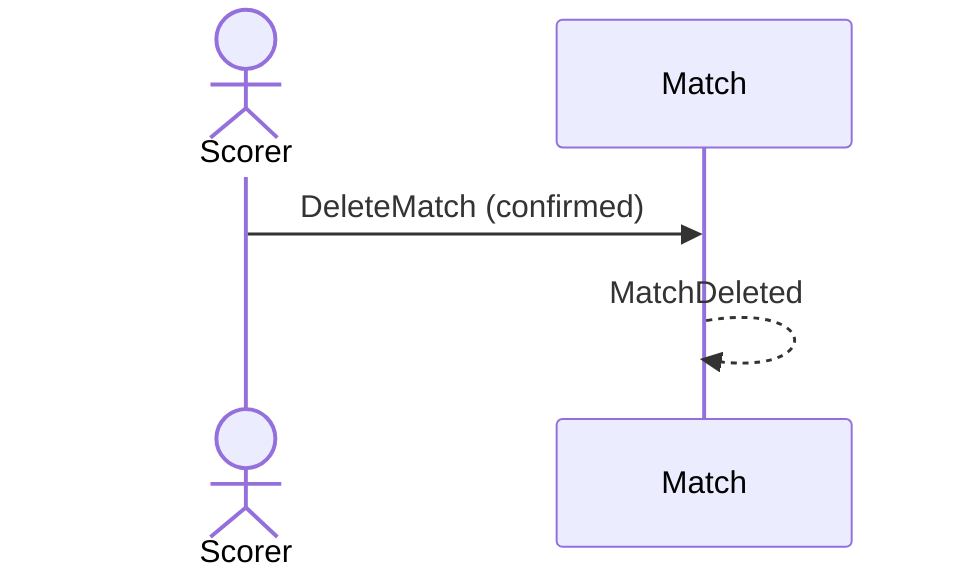

# 30 — Delete a match

**Type:** YOU
**Status:** new
**Source:** none
**History:** ADR-0001 (baseline)
**Actor:** Scorer
**Trigger / interface:** Past matches: swipe a row to reveal delete → confirmation dialog
**Description:** Removes the match permanently from history and stats. Different from cancelling, which keeps it.

## Relations
- Triggered by: [17]; [42] (removing a player deletes their matches)

## Inputs
- Confirmation

## Rules
- Only ended matches (finished, abandoned, cancelled)

## Flow
1. Swipe, tap delete, confirm

## Failure paths
- Declined → nothing changes

## Domain Events Raised
- `MatchDeleted`

## Reactions
- none

## Aggregates Touched
- `Match`

## External Systems
- none

## Sequence Diagram

