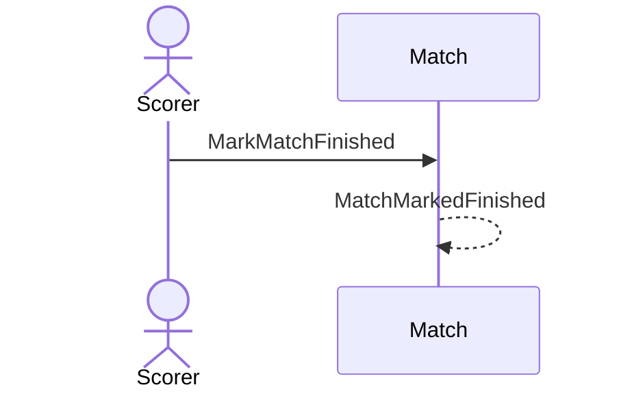

# 31 — Turn an abandoned match into a finished one

**Type:** YOU
**Status:** new
**Source:** none
**History:** ADR-0001 (baseline)
**Actor:** Scorer
**Trigger / interface:** Past match → mark as finished
**Description:** The result counts after all. Recorded as a correction; the match counts in stats from then on. Finished can never become abandoned.

## Relations
- Triggered by: [17]
- Depends on: [25]

## Inputs
- Confirmation

## Rules
- Only abandoned → finished
- Winner as for finishing early: whoever is ahead; level is a draw

## Flow
1. Scorer marks the match finished

## Failure paths
- Match not abandoned → not offered

## Domain Events Raised
- `MatchMarkedFinished`

## Reactions
- none

## Aggregates Touched
- `Match`

## External Systems
- none

## Sequence Diagram

