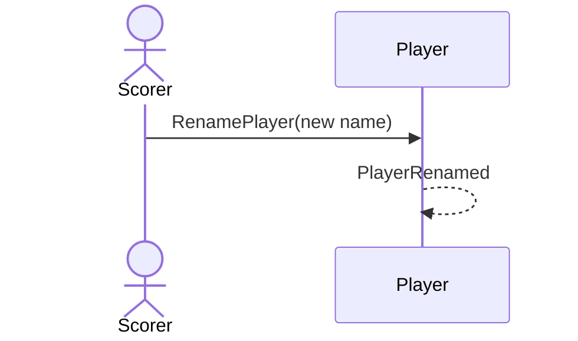

# 32 — Rename a player

**Type:** YOU
**Status:** new
**Source:** none
**History:** ADR-0001 (baseline)
**Actor:** Scorer
**Trigger / interface:** Settings → Players → a player → rename
**Description:** Every past match, template and series shows the new name (matches refer to the player, not the name).

## Relations
- none

## Inputs
- New name

## Rules
- Unique, case-insensitive, not blank
- An archived player's name is blocked, with the offer to remove that player (→ 42)

## Flow
1. Scorer enters the new name; saves

## Failure paths
- Name taken by an active player → refused
- Name of an archived player → blocked; offer removal (→ 42)

## Domain Events Raised
- `PlayerRenamed` — old, new

## Reactions
- none

## Aggregates Touched
- `Player`

## External Systems
- none

## Sequence Diagram

