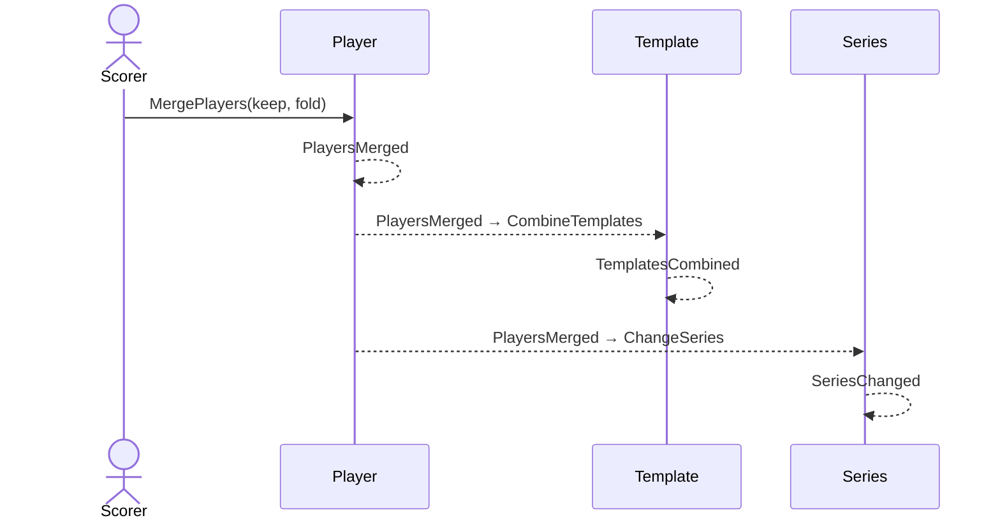

# 33 — Merge two players

**Type:** YOU
**Status:** new
**Source:** none
**History:** ADR-0001 (baseline)
**Actor:** Scorer
**Trigger / interface:** Settings → Players → merge: pick the player to keep and the one to fold in
**Description:** For two records of the same person ("Cal" and "Callum"). Every match, template and series setup of the folded-in player moves to the kept one; the folded-in player is gone.

## Relations
- Triggers: template combining (→ 12's templates), series changes (→ 40's series), Me follows (→ 45)

## Inputs
- Player to keep, player to fold in

## Rules
- Refused if the two have ever played each other (it would create a match against yourself)
- Templates that become identical combine into one; use counts add up
- If the folded-in player was "Me", Me follows the kept player

## Flow
1. Scorer picks both players; confirms
2. References move; duplicates combine

## Failure paths
- They have played each other → refused

## Domain Events Raised
- `PlayersMerged` — kept, folded in

## Reactions
- when `PlayersMerged` → combine identical templates (`TemplatesCombined`); repoint series setups (`SeriesChanged`); Me follows the kept player

## Aggregates Touched
- `Player`, `Match`, `Template`, `Series`, `Preferences`

## External Systems
- none

## Sequence Diagram

