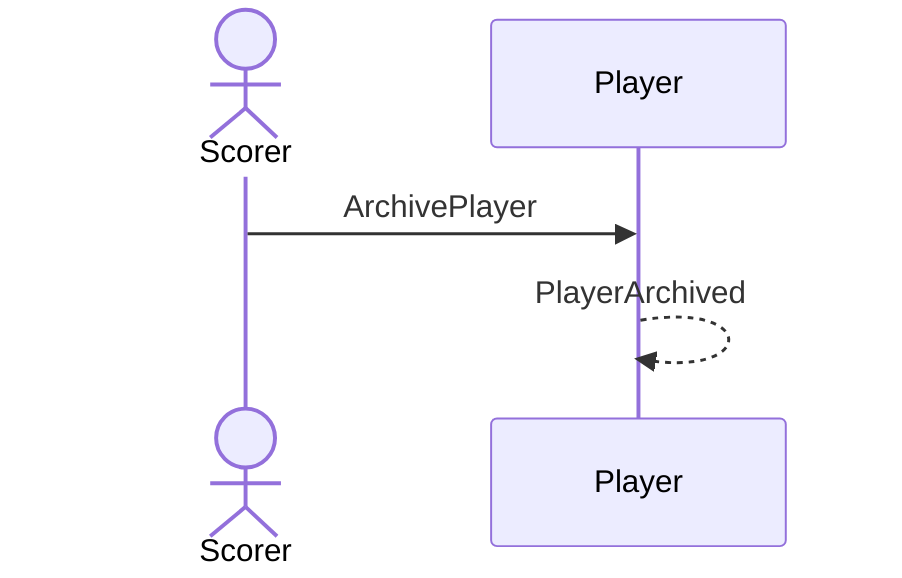

# 34 — Archive a player

**Type:** YOU
**Status:** new
**Source:** none
**History:** ADR-0001 (baseline)
**Actor:** Scorer
**Trigger / interface:** Settings → Players → archive
**Description:** For someone no longer played. They disappear from name suggestions; their templates are hidden; their matches drop out of past matches and stats unless "include archived players" is on; series keep their setups, hidden.

## Relations
- Related: [35] reverses; [42] removes completely

## Inputs
- Player

## Rules
- Refused while the player is in a live match
- Players are never deleted directly, only archived (then optionally removed, 42)

## Flow
1. Scorer archives the player

## Failure paths
- In a live match → refused

## Domain Events Raised
- `PlayerArchived`

## Reactions
- none (hiding is a read-side filter)

## Aggregates Touched
- `Player`

## External Systems
- none

## Sequence Diagram

