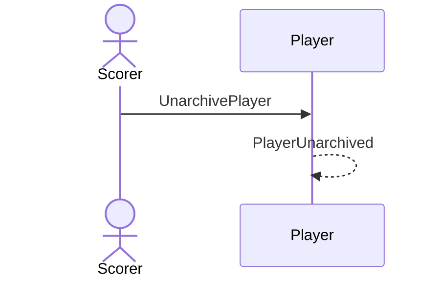

# 35 — Unarchive a player

**Type:** YOU
**Status:** new
**Source:** none
**History:** ADR-0001 (baseline)
**Actor:** Scorer
**Trigger / interface:** Settings → Players (archived) → unarchive
**Description:** Everything archiving hid comes back as it was.

## Relations
- Depends on: [34]

## Inputs
- Player

## Rules
- Player is archived

## Flow
1. Scorer unarchives the player

## Failure paths
- none

## Domain Events Raised
- `PlayerUnarchived`

## Reactions
- none

## Aggregates Touched
- `Player`

## External Systems
- none

## Sequence Diagram

