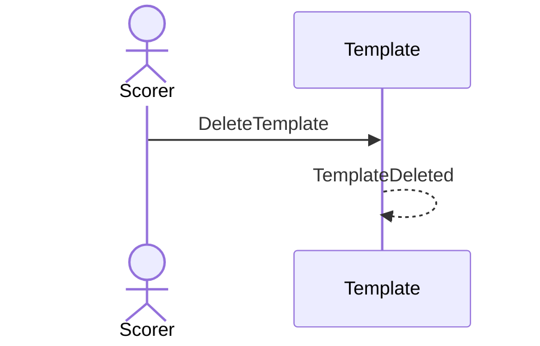

# 36 — Delete a template

**Type:** YOU
**Status:** new
**Source:** none
**History:** ADR-0001 (baseline) · ADR-0010 (changed: paid)
**Actor:** Scorer
**Trigger / interface:** Template list: swipe left → delete
**Description:** Removes the template from the list. Playing the same setup again recreates it (12), with its use count restarting.

## Relations
- Related: [12]

## Inputs
- Template

## Rules
- **Edition (ADR-0010):** Paid. While the edition is Free, this opens the upgrade offer (→ 52)
- none

## Flow
1. Swipe left, delete

## Failure paths
- none

## Domain Events Raised
- `TemplateDeleted`

## Reactions
- none

## Aggregates Touched
- `Template`

## External Systems
- none

## Sequence Diagram

