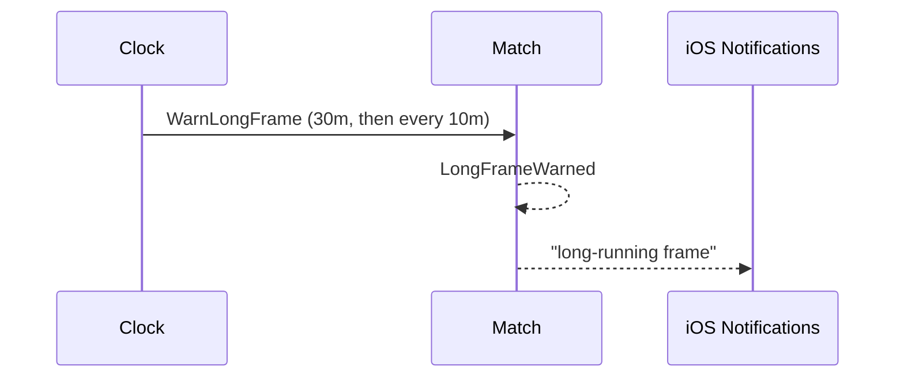

# 37 — Warn about a long frame

**Type:** AUTO
**Status:** new
**Source:** none
**History:** ADR-0001 (baseline)
**Actor:** Clock
**Trigger / interface:** A frame has run 30 minutes (not counting paused time); then every 10 minutes
**Description:** A phone notification, "warning: long-running frame", that works with the app in the background.

## Relations
- Triggered by: frame timer started by [1], [2], [5]; stopped by [7], [27], [10], [25], [26]; resumed by [8]

## Inputs
- none

## Rules
- First warning at 30 minutes, then every 10 minutes (40, 50, …) until the frame ends or the match is paused
- Thresholds are fixed (not settings)

## Flow
1. Frame timer reaches 30 min → warn; repeat every 10 min

## Failure paths
- Notifications disallowed → no warning; nothing else changes

## Domain Events Raised
- `LongFrameWarned` — match, frame, elapsed

## Reactions
- when `LongFrameWarned` → iOS notification

## Aggregates Touched
- `Match`

## External Systems
- iOS Notifications

## Sequence Diagram

