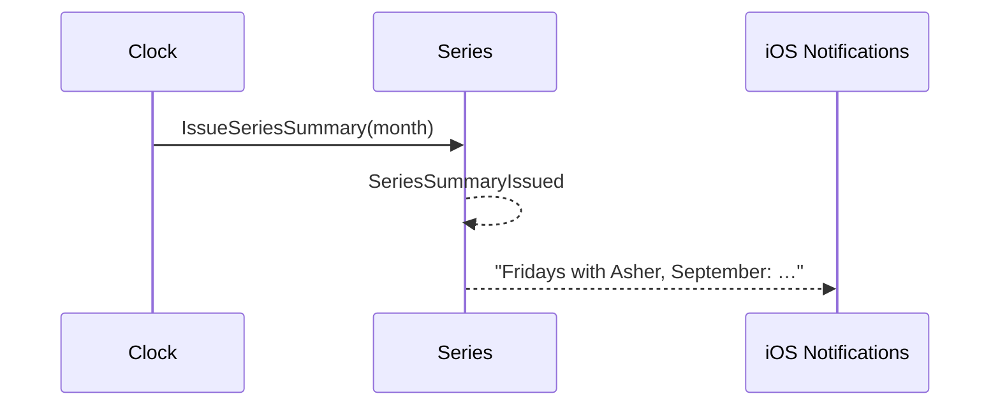

# 38 — Monthly series summary

**Type:** AUTO
**Status:** new [?]
**Source:** none
**History:** ADR-0001 (baseline) · ADR-0010 (changed: paid)
**Actor:** Clock
**Trigger / interface:** 1st of each month, covering the previous month
**Description:** For each series with at least one match last month, a notification ("Fridays with Asher, September: you 3–1 in matches, 22–17 in frames") opens a summary screen with the stats figures for that series and month, and the change since the previous month.

## Relations
- Depends on: [39]; figures as [18]

## Inputs
- none

## Rules
- **Edition (ADR-0010):** Paid. No summary is issued while Free
- Only series with matches in the month
- "You" only when Me is set and in the series; otherwise each pairing's results are listed
- Series are small groups between friends; leagues are out of scope

## Flow
1. On the 1st, a summary per active series is issued and notified

## Failure paths
- Notifications disallowed → summary still available in the app
- Deferred: a match ends while the summary is being made (Q5)

## Domain Events Raised
- `SeriesSummaryIssued` — series, month

## Reactions
- when `SeriesSummaryIssued` → iOS notification

## Aggregates Touched
- `Series`, `Match` (read)

## External Systems
- iOS Notifications

## Sequence Diagram

