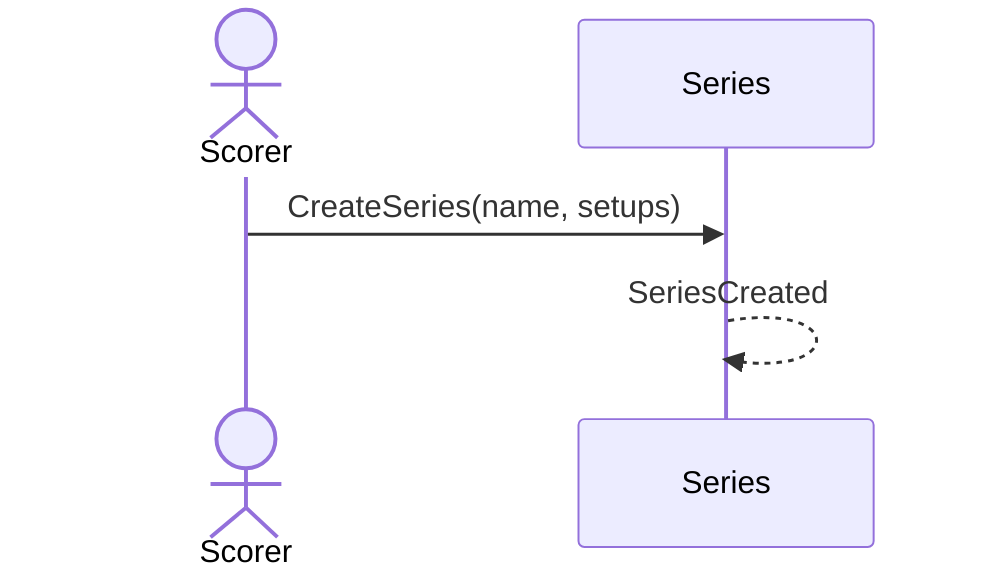

# 39 — Create a series

**Type:** YOU
**Status:** new
**Source:** none
**History:** ADR-0001 (baseline) · ADR-0010 (changed: paid)
**Actor:** Scorer
**Trigger / interface:** Main menu → Series → new
**Description:** A named group of setups (e.g. "Fridays with Asher"). Every past and future match with one of its setups belongs to it. Series are a stats filter and get a monthly summary (38).

## Relations
- Triggers: [38] (monthly)
- Related: [40]

## Inputs
- Name; one or more setups

## Rules
- **Edition (ADR-0010):** Paid. While the edition is Free, this opens the upgrade offer (→ 52)
- A setup can be in several series

## Flow
1. Scorer names the series and picks setups

## Failure paths
- No name → cannot save

## Domain Events Raised
- `SeriesCreated`

## Reactions
- none

## Aggregates Touched
- `Series`

## External Systems
- none

## Sequence Diagram

