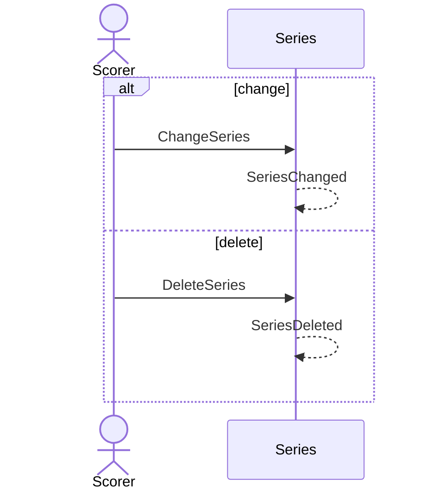

# 40 — Change or delete a series

**Type:** YOU
**Status:** new
**Source:** none
**History:** ADR-0001 (baseline)
**Actor:** Scorer
**Trigger / interface:** Series screen → a series → rename, add/remove setups, delete
**Description:** Changes which setups a series covers, or deletes it. Matches are unaffected.

## Relations
- Depends on: [39]
- Also changed by: [33], [42] (setups repointed / removed)

## Inputs
- Name and/or setups; or delete confirmation

## Rules
- Deleting a series never deletes matches

## Flow
1. Scorer edits or deletes

## Failure paths
- none

## Domain Events Raised
- `SeriesChanged`
- `SeriesDeleted`

## Reactions
- none

## Aggregates Touched
- `Series`

## External Systems
- none

## Sequence Diagram

