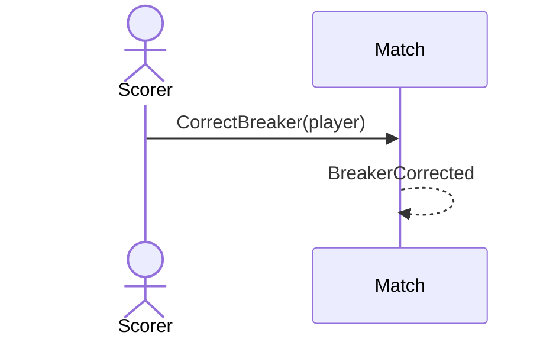

# 41 — Correct the breaker

**Type:** YOU
**Status:** new
**Source:** none
**History:** ADR-0001 (baseline)
**Actor:** Scorer
**Trigger / interface:** Match menu (burger) → correct breaker
**Description:** Sets who is breaking now; the break rule carries on from the corrected player.

## Relations
- Depends on: [4]
- Triggers: [47] via `BreakerCorrected`

## Inputs
- Player breaking now

## Rules
- Match is live (allowed while paused, via the menu)

## Flow
1. Scorer picks the right breaker

## Failure paths
- none

## Domain Events Raised
- `BreakerCorrected`

## Reactions
- when `BreakerCorrected` → update the lock screen (→ scenario 47)

## Aggregates Touched
- `Match`

## External Systems
- none

## Sequence Diagram

