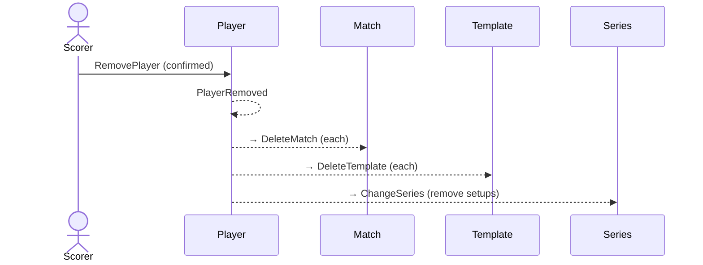

# 42 — Remove an archived player

**Type:** YOU
**Status:** new
**Source:** none
**History:** ADR-0001 (baseline)
**Actor:** Scorer
**Trigger / interface:** Settings → Players (archived) → remove; or offered when typing / renaming to an archived player's name (2, 3, 32). Confirmation dialog.
**Description:** Permanently removes the player and all their matches. Their templates go, their setups are taken out of series, and the name becomes free.

## Relations
- Triggered by: [2], [3], [32] (offer)
- Triggers: [30] for each of their matches
- Depends on: [34]

## Inputs
- Confirmation

## Rules
- Only archived players
- If the player was "Me", Me is cleared

## Flow
1. Scorer confirms removal
2. Player removed; reactions clean up

## Failure paths
- Declined → nothing changes

## Domain Events Raised
- `PlayerRemoved`

## Reactions
- when `PlayerRemoved` → delete each of their matches (`MatchDeleted`, → scenario 30); delete their templates (`TemplateDeleted`); remove their setups from series (`SeriesChanged`); clear Me

## Aggregates Touched
- `Player`, `Match`, `Template`, `Series`, `Preferences`

## External Systems
- none

## Sequence Diagram

