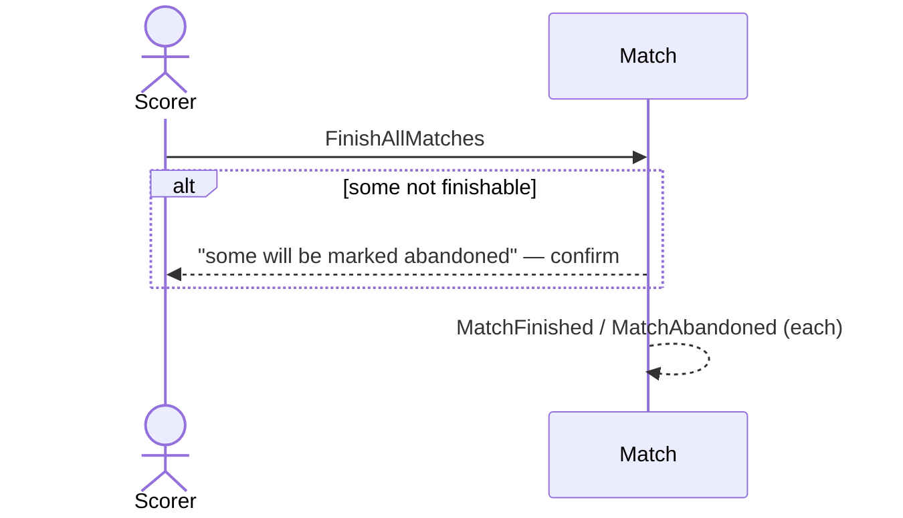

# 43 — Finish all live matches

**Type:** YOU
**Status:** new
**Source:** none
**History:** ADR-0001 (baseline)
**Actor:** Scorer
**Trigger / interface:** Live matches list → Finish all → confirmation
**Description:** If every live match can be finished, all are finished. Otherwise one dialog says some matches aren't complete and will be marked abandoned; on confirm, finishable ones are finished and the rest abandoned.

## Relations
- Triggers: [10], [25] per match

## Inputs
- Confirmation

## Rules
- Finishable: most frames wins (any time), or a target style whose target is reached
- Race to / sets short of target → abandoned

## Flow
1. Scorer taps Finish all; dialog; confirms

## Failure paths
- Declined → nothing changes

## Domain Events Raised
- `MatchFinished` / `MatchAbandoned` per match

## Reactions
- as scenarios 10 and 25

## Aggregates Touched
- `Match`

## External Systems
- none

## Sequence Diagram

