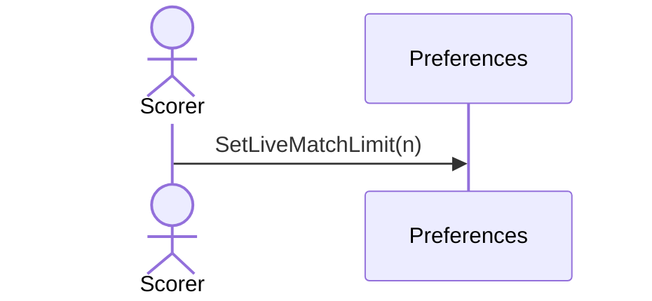

# 44 — Set the live-match limit

**Type:** YOU
**Status:** new
**Source:** none
**History:** ADR-0001 (baseline) · ADR-0010 (changed: paid)
**Actor:** Scorer
**Trigger / interface:** Settings → maximum live matches
**Description:** Caps how many matches can be live at once.

## Relations
- Used by: [1], [2], [11]

## Inputs
- A number

## Rules
- **Edition (ADR-0010):** Paid. While the edition is Free, this opens the upgrade offer (→ 52). While Free the limit is fixed at 1
- Default 10; 1 to 100

## Flow
1. Scorer sets the number

## Failure paths
- Out of range → refused

## Domain Events Raised
- raises nothing (a setting)

## Reactions
- none

## Aggregates Touched
- `Preferences`

## External Systems
- none

## Sequence Diagram

