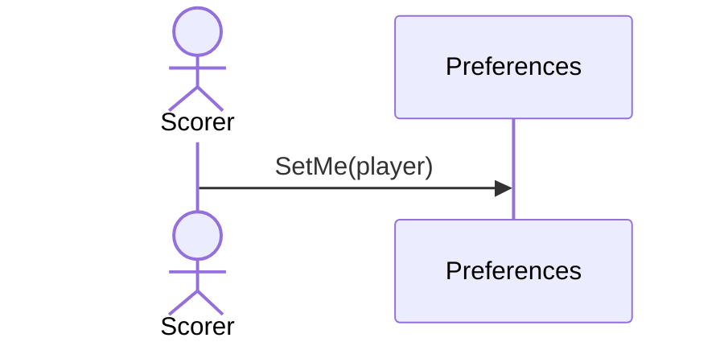

# 45 — Set who I am

**Type:** YOU
**Status:** new
**Source:** none
**History:** ADR-0001 (baseline)
**Actor:** Scorer
**Trigger / interface:** Main menu (enter your name) or Settings; also first launch (48)
**Description:** Marks one player as the device owner, shown as **Me (Callum)**. Stats default to Me's record against each opponent.

## Relations
- Triggered by: [48]
- Used by: [18], [19], [38]
- Changed by: [33] (follows the kept player), [42] (cleared)

## Inputs
- A player name (existing, or new → scenario 3)

## Rules
- Optional; until set, stats ask which player to look at

## Flow
1. Scorer enters or picks their name

## Failure paths
- none

## Domain Events Raised
- raises nothing (a setting)

## Reactions
- none

## Aggregates Touched
- `Preferences`, `Player` (if new)

## External Systems
- none

## Sequence Diagram

