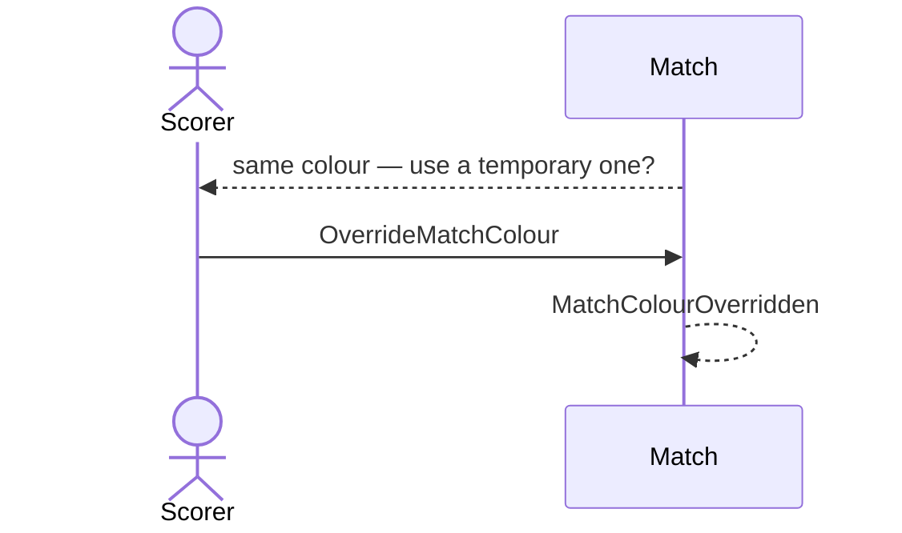

# 46 — Offer a temporary colour

**Type:** AUTO
**Status:** new
**Source:** none
**History:** ADR-0001 (baseline) · ADR-0010 (changed: paid)
**Actor:** policy (reaction to `MatchStarted`)
**Trigger / interface:** A match starts with both players the same colour
**Description:** Asks whether to give one player a random different colour for this match only. Saved player colours don't change.

## Relations
- Triggered by: [1], [2] via `MatchStarted`
- Related: [22]

## Inputs
- Yes / no

## Rules
- **Edition (ADR-0010):** Paid. Not offered while Free (no colours are shown)
- Only when both colours match

## Flow
1. Prompt; on yes, a random different colour is applied to one player in this match

## Failure paths
- No → both keep the same colour

## Domain Events Raised
- `MatchColourOverridden` — player, colour

## Reactions
- none

## Aggregates Touched
- `Match`

## External Systems
- none

## Sequence Diagram

