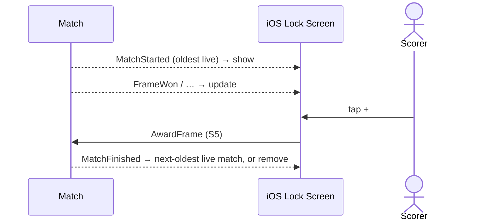

# 47 — Live match on the lock screen

**Type:** AUTO
**Status:** new [?]
**Source:** none
**History:** ADR-0001 (baseline) · ADR-0004 (changed: the oldest live match, handing over to the next-oldest) · ADR-0010 (changed: paid)
**Actor:** policy (reaction to match events)
**Trigger / interface:** iOS Live Activity
**Description:** The oldest live match shows on the lock screen with score, breaker dot and frame timer, and buttons: + for each player and pause/resume. Matches started later don't appear until it ends; then the next-oldest takes over. Anything needing a decision (first breaker, Finish/Continue prompts, −) opens the app.

## Relations
- Triggered by: `MatchStarted` [1, 2], `BreakerChosen` [4], `FrameWon` [5], `FrameRemoved` [6], `MatchPaused` [7], `MatchResumed` [8], `BreakerCorrected` [41], `MatchAutoPaused` [27]; handed over or removed on `MatchFinished` [10], `MatchAbandoned` [25], `MatchCancelled` [26]
- Triggers: [5], [7], [8] (lock-screen buttons)

## Inputs
- none

## Rules
- **Edition (ADR-0010):** Paid. No Live Activity while Free; it is removed when the purchase is revoked (51)
- Exactly one Live Activity: the oldest live match (earliest start; ties by creation order, as the live list)
- Later matches don't appear while it is live
- Its buttons act on that match only; lock-screen + is the same command as scenario 5

## Flow
1. A match starts with no other live match → Live Activity shown for it. A match starts while another is live → no change
2. Updated on every change to the shown match; buttons send commands
3. The shown match ends → the activity moves to the next-oldest live match, or is removed if none is left

## Failure paths
- Live Activities disabled → nothing shown
- Deferred: lock-screen + at the same moment as an in-app − (Q4)

## Domain Events Raised
- raises nothing (projection; its buttons raise `FrameWon`, `MatchPaused`, `MatchResumed` via scenarios 5, 7, 8)

## Reactions
- none

## Aggregates Touched
- `Match` (read)

## External Systems
- iOS Live Activities (lock screen)

## Sequence Diagram

