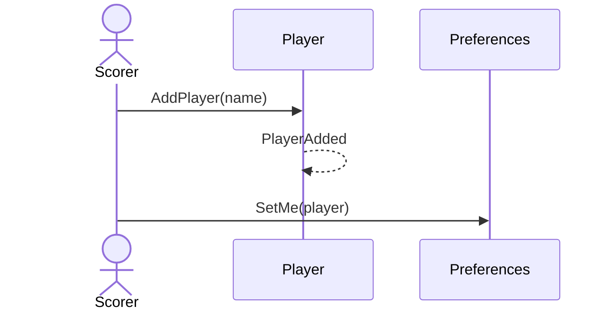

# 48 — First-launch welcome

**Type:** YOU
**Status:** new
**Source:** none
**History:** ADR-0001 (baseline)
**Actor:** Scorer
**Trigger / interface:** First launch after install
**Description:** Asks the scorer's name, which creates them as a player and sets Me (45), then gives a quick walkthrough of running a match. The walkthrough can be skipped and replayed from settings.

## Relations
- Triggers: [3] (player created), [45] (Me set)

## Inputs
- Name

## Rules
- Same name rules as scenario 3

## Flow
1. Welcome; enter name
2. Walkthrough (skippable)
3. Main menu

## Failure paths
- Blank name → cannot continue (walkthrough can still be skipped)

## Domain Events Raised
- `PlayerAdded`

## Reactions
- none

## Aggregates Touched
- `Player`, `Preferences`

## External Systems
- none

## Sequence Diagram

