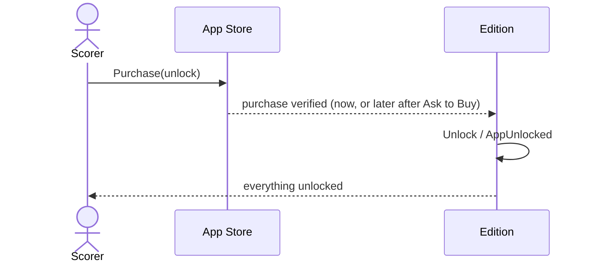

# 49 — Unlock full version

**Type:** YOU
**Status:** new
**Source:** none
**History:** ADR-0010 (added)
**Actor:** Scorer
**Trigger / interface:** "Upgrade once, unlock forever" button on the upgrade offer (52) or the benefits screen (53)
**Description:** A one-off in-app purchase (about £2.99) through the App Store that unlocks every paid feature on this device for good. It is not a subscription, and Family Sharing is on.

## Relations
- Triggered by: [52], [53] (the button)
- Unlocks: [1], [7], [8], [11], [12], [14], [15], [16], [18], [19], [21], [22], [36], [38], [39], [40], [43], [44], [46], [47]; lifts the limits in [2], [3], [17], [29], [30], [33], [34], [35]
- Related: [50] (same end state), [51] (the reverse)

## Inputs
- None (the App Store handles payment and identity)

## Rules
- The edition is Free
- Nothing unlocks until the App Store confirms the purchase

## Flow
1. Scorer taps the button; the App Store payment sheet appears
2. The App Store confirms the purchase
3. The edition becomes Unlocked and is cached on the device
4. Hidden matches, colours, templates and stats appear straight away; the benefits menu item (53) disappears

## Failure paths
- Cancelled or the payment failed → nothing changes, and the offer stays
- Pending (Ask to Buy) → nothing unlocks yet. When the approval arrives, even after a restart, the App Store notifies the app and it unlocks automatically
- Offline → the App Store sheet reports it; nothing changes

## Domain Events Raised
- `AppUnlocked` — the device's edition became Unlocked

## Reactions
- when `AppUnlocked` → the benefits menu item is hidden (53); hidden matches beyond the newest 10 are shown (17)

## Aggregates Touched
- `Edition`

## External Systems
- App Store (StoreKit)

## Sequence Diagram

