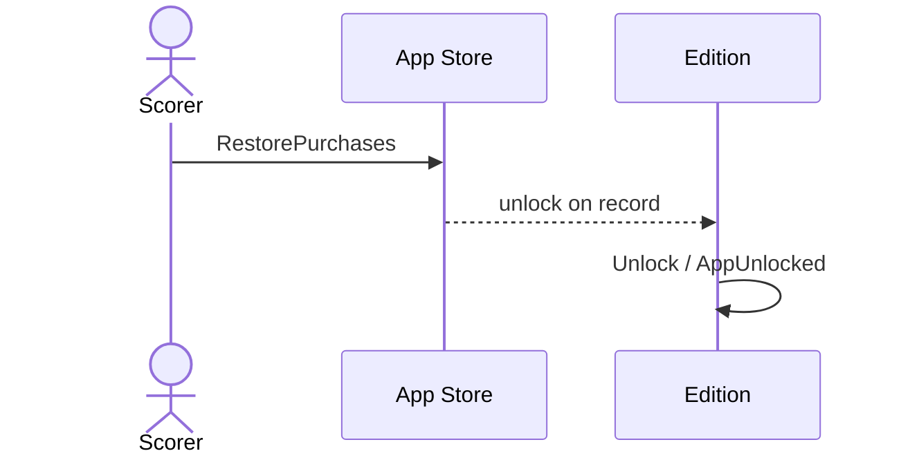

# 50 — Restore purchase

**Type:** YOU
**Status:** new
**Source:** none
**History:** ADR-0010 (added)
**Actor:** Scorer
**Trigger / interface:** "Restore" link on the upgrade screen (52, 53)
**Description:** Unlocks a new phone, a reinstall or a family member's device using a purchase the App Store already has on record. Apple requires this option.

## Relations
- Triggered by: [52], [53] (the link)
- Related: [49] (same end state)

## Inputs
- None

## Rules
- The edition is Free

## Flow
1. Scorer taps Restore
2. The App Store returns the purchases on record (including Family Sharing)
3. The unlock is on record → the edition becomes Unlocked

## Failure paths
- No purchase on record → "Nothing to restore"; stays Free
- Offline → "Couldn't reach the App Store"; stays Free

## Domain Events Raised
- `AppUnlocked`

## Reactions
- when `AppUnlocked` → same as 49

## Aggregates Touched
- `Edition`

## External Systems
- App Store (StoreKit)

## Sequence Diagram

