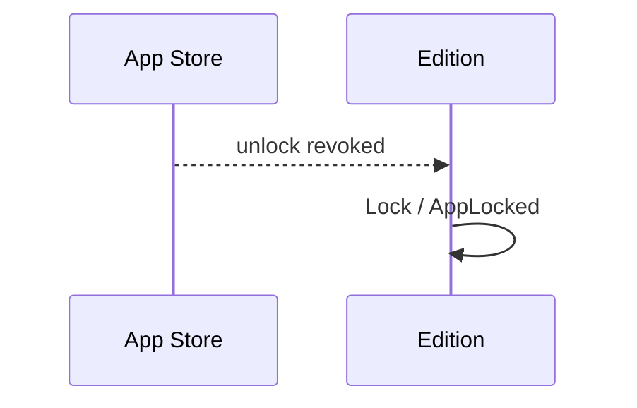

# 51 — Purchase revoked

**Type:** AUTO
**Status:** new
**Source:** none
**History:** ADR-0010 (added)
**Actor:** App Store
**Trigger / interface:** The App Store reports that the unlock was revoked: a refund, or Family Sharing ending
**Description:** Returns the device to the Free edition without deleting anything.

## Relations
- Reverses: [49], [50]

## Inputs
- The revocation from the App Store

## Rules
- The edition is Unlocked
- Nothing is deleted or rewritten

## Flow
1. The App Store reports the revocation (at launch or while running)
2. The edition becomes Free
3. Free limits apply again:
   - Colours are hidden
   - Matches beyond the newest 10 are hidden
   - Templates, stats, series and the lock screen are locked
   - The benefits menu item (53) reappears
4. Live matches keep their style and break rule and run to the end; no new paid feature can be started
5. Players over the cap stay; no new player can be added, or unarchived, until fewer than 5 are active

## Failure paths
- Offline → the cached edition stays until the App Store can be reached

## Domain Events Raised
- `AppLocked` — the device's edition went back to Free

## Reactions
- when `AppLocked` → the benefits menu item is shown (53); the Live Activity is removed (47)

## Aggregates Touched
- `Edition`

## External Systems
- App Store (StoreKit)

## Sequence Diagram

